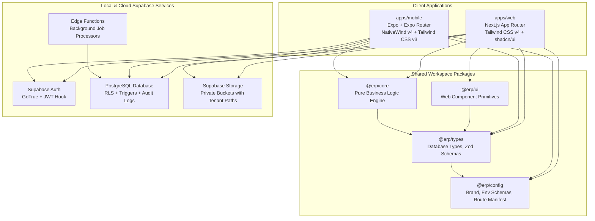
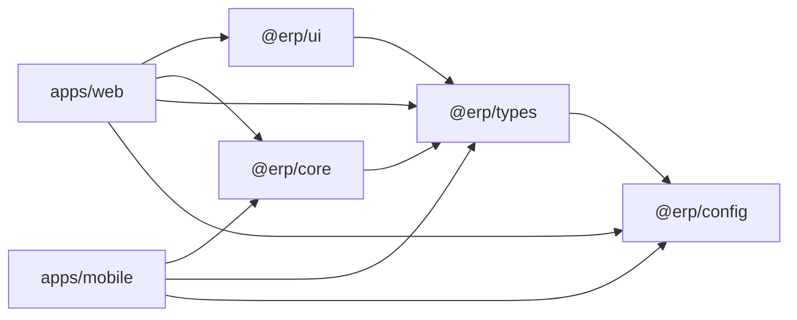
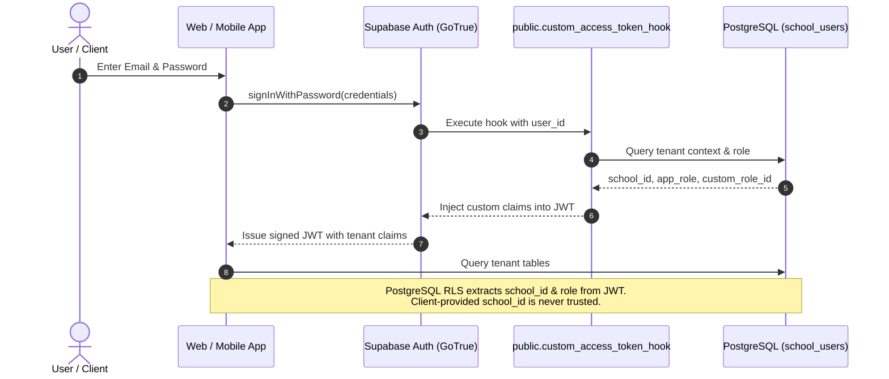

# Architecture Specification (docs/ARCHITECTURE.md)

This document outlines the architectural topology, package dependency boundaries, authentication mechanics, and cross-platform design token strategy for the ERP multi-tenant platform.

---

## 1. System Architecture Topology

---

## 2. Cross-Platform Design Token Architecture

> [!NOTE]
> **Tailwind v4 (Web) and Tailwind v3 (Mobile) Token Emission Strategy**:
> `apps/web` leverages **Tailwind CSS v4** (which utilizes a Rust-based engine with pure CSS-first `@theme` declarations and `@tailwindcss/postcss`), whereas `apps/mobile` utilizes **NativeWind v4** (which is engineered for and strictly requires **Tailwind CSS v3** JavaScript presets via `tailwind.config.js`).
>
> To maintain strict visual parity across both platforms without code duplication, design tokens specified in [DESIGN_SYSTEM.md](DESIGN_SYSTEM.md) are authored **once** as canonical TypeScript definitions in `@erp/config`. From that single source of truth, tokens are emitted through two distinct targets:
> 1. **Web Target**: Formatted into CSS Custom Properties (`:root` / `@theme` variables) imported by `apps/web/app/globals.css`.
> 2. **Mobile Target**: Formatted into a JavaScript theme extension preset consumed by `apps/mobile/tailwind.config.js`.
>
> *(Note: Token definitions will be populated in subsequent module milestones).*

---

## 3. Package Dependency & Boundary Rules

### Strict Isolation Invariants:
1. **Core Business Logic (`@erp/core`)**: Must remain 100% runtime and framework agnostic. ESLint rules enforce:
   - `no-restricted-globals`: `window`, `document`, `localStorage`, `navigator` are forbidden.
   - `no-restricted-imports`: `react`, `react-dom`, `react-native`, `expo`, and `nativewind` are strictly blocked.
2. **Type Contracts (`@erp/types`)**: Pure TypeScript types and Zod validation schemas. Zero runtime dependencies on UI or platform APIs.
3. **Web UI (`@erp/ui`)**: Exclusively serves web client components using shadcn/ui patterns and Tailwind CSS. Never imported by `@erp/mobile`.
4. **Environment Isolation (`@erp/config`)**:
   - `env.public.ts`: Safe for client and browser bundles. Inlines `NEXT_PUBLIC_*` properties explicitly.
   - `env.server.ts`: Guarded by `server-only`. Houses private backend keys (`SUPABASE_SERVICE_ROLE_KEY`) and cannot be imported into client components.

---

## 4. Multi-Tenant Authentication & Custom Claims Hook

---

## 5. Technology Stack Summary

| Layer | Technology | Primary Function |
| :--- | :--- | :--- |
| **Monorepo Engine** | Turborepo (`turbo`) + pnpm | Task scheduling, caching, dependency resolution |
| **Web Framework** | Next.js 16 (App Router) | Server-side rendering, React Server Components, SSR Auth |
| **Web Styling** | Tailwind CSS v4 + shadcn/ui | Utility-first CSS styling, Radix accessibility primitives |
| **Mobile Framework** | Expo SDK 57 (Expo Router) | Cross-platform iOS/Android native applications |
| **Mobile Styling** | NativeWind v4 + Tailwind CSS v3 | React Native styling parity with web tokens |
| **Database & Auth** | Supabase (PostgreSQL 15) | Multi-tenant row level security, Auth custom claims hook |
| **Business Logic** | `@erp/core` (TypeScript) | Pure domain logic: half-up rounding, fee calculations |
| **Validation** | Zod | Shared client/server schema validation |
| **Testing** | Vitest + Playwright + pgTAP | Unit tests, end-to-end browser tests, database RLS tests |
| **Linting & Quality** | ESLint v9 Flat Config + Prettier | Code quality, import barriers, pre-commit enforcement |

---

## 6. Installed Versions (as of 2026-10-18)

| Package / Tool | Version | Notes |
| :--- | :--- | :--- |
| `next` | `16.4.2` | Latest stable Next.js App Router |
| `react` | `19.2.3` | Unified React 19 across web (`^19.0.0`) and mobile (`19.2.3`) |
| `react-native` | `0.86.3` | Installed by Expo SDK 57 manifest |
| `expo` | `57.0.30` | Latest stable Expo SDK 57 release |
| `tailwindcss` (web) | `4.0.9` | Tailwind CSS v4 with `@tailwindcss/postcss` |
| `tailwindcss` (mobile) | `3.4.17` | Tailwind CSS v3 required by NativeWind v4 |
| `nativewind` | `4.2.7` | Tailwind CSS bridge for React Native |
| `eslint` | `9.22.0` | Flat Config (v9 compatible with React 19 plugins) |
| `typescript` | `5.8.2` / `6.0.3` | Root/Web: `5.8.2`; Mobile: `6.0.3` (aligned with Expo SDK 57) |
| `zod` | `3.24.2` | Universal schema validation |
| `supabase` | `2.121.0` | Supabase CLI dev dependency |

---

## 7. Metro Bundler Resolution & Hoisting Verification

- **Evaluation**: Mobile bundling was tested without `nodeLinker: hoisted` on Expo SDK 57 (`react-native` 0.86.3, `expo-router` 57.0.28).
- **Result**: `npx expo export --platform android --no-bytecode` successfully compiled 1257 modules into a 1.8MB bundle (`entry-e53ef33e2810baa459c3cee972c269bd.js`) and emitted assets without error in standard isolated pnpm mode.
- **Decision**: `nodeLinker: hoisted` is **not required** and has been omitted from `.npmrc` and `pnpm-workspace.yaml`, preserving pnpm's strict dependency isolation.

