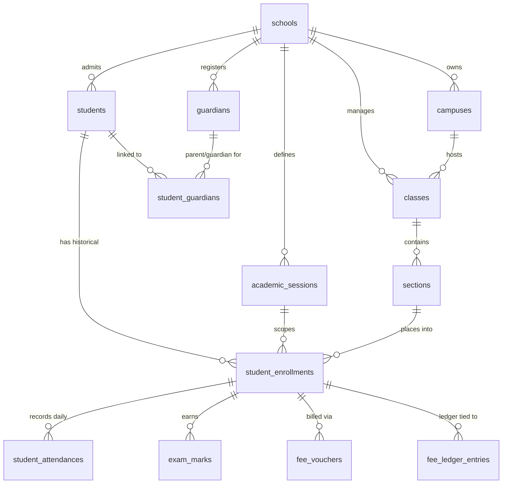
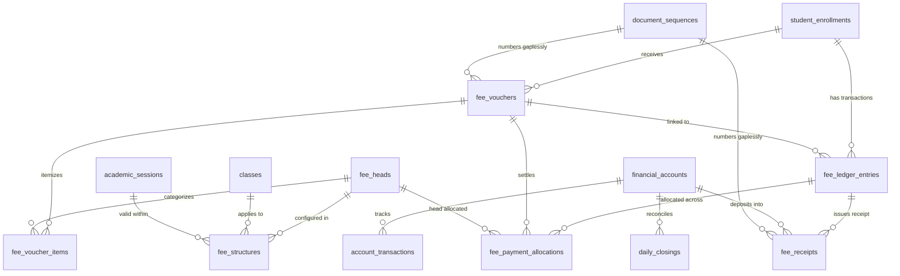
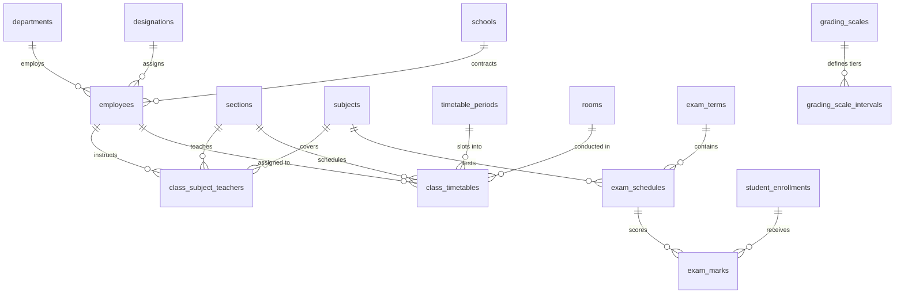

# Database Architecture & Data Model (DATA_MODEL.md)

## 1. Architectural Invariants & Data Governance

### 1.1 Multi-Tenancy via PostgreSQL Row Level Security (RLS)
1. **Tenant Anchor**: Every tenant table contains a mandatory, non-nullable foreign key column `school_id uuid NOT NULL REFERENCES schools(id) ON DELETE RESTRICT`. All tenant-level deletions require explicit administrative de-provisioning workflows.
2. **JWT Custom Claims Execution**: Database RLS policies extract tenant context and user authorization exclusively from Supabase Auth JWT claims:
   - `auth.jwt() ->> 'school_id'` (UUID of the active tenant school)
   - `auth.jwt() ->> 'app_role'` (System role: `super_admin`, `school_admin`, `accountant`, `teacher`, `student`, `parent`)
   - `auth.jwt() ->> 'sub'` (User UUID)
3. **Client Isolation**: Client-supplied tenant identifiers in request payloads or query parameters are never trusted by security policies.
4. **Tenant Table Indexing**: Every table includes an index on `school_id` and composite indexes on `(school_id, [filter_columns])` to ensure fast index scans under RLS filtering.

### 1.2 Enrollment-Centric Historical Immutability
1. **Physical Identity vs. Academic Placement**:
   - `students` models the physical human being (name, gender, date of birth, national ID, medical notes, convenience link to primary guardian).
   - `student_enrollments` places that person into an `academic_session_id`, `class_id`, `section_id`, and assigns a `roll_number`.
2. **Foreign Key Integrity**:
   - Academic and financial child records—including `student_attendances`, `exam_marks`, `fee_vouchers`, `fee_ledger_entries`, `fee_receipts`, `student_transport_subscriptions`, and `hostel_allocations`—**reference `enrollment_id` (foreign key to `student_enrollments(id)` ON DELETE RESTRICT), NOT `student_id`**.
   - This prevents historical pollution: when a student is promoted to the next grade in a new academic year, all past marks, attendance records, and fee ledgers remain permanently bound to their prior enrollment record.

### 1.3 Financial Integrity & Append-Only Fee Ledger
1. **Immutable Ledger**: `fee_ledger_entries` is strictly append-only. Storing mutable balance fields on `students` or `fee_vouchers` is prohibited. Updating or deleting ledger rows is prevented by database triggers.
2. **Signed Minor Units & Balance Calculation**:
   - `fee_ledger_entries.amount` is a signed `bigint` minor unit value:
     - **Positive (`amount > 0`)**: Increases what the student owes the school (charges, late fines, refunds issued to student/parent).
     - **Negative (`amount < 0`)**: Lowers what the student owes the school (payments, discounts, waivers, advance credits applied).
   - `entry_type` is an audit and reporting classification label only.
   - Student or enrollment balance is computed dynamically as:
     $$\text{Balance} = \sum (\text{amount})$$
3. **Ledger Check Constraints**:
   - `amount <> 0` (zero-amount ledger entries are forbidden).
   - `entry_type IN ('charge', 'fine', 'refund')` requires `amount > 0`.
   - `entry_type IN ('payment', 'discount', 'advance_applied')` requires `amount < 0`.
   - `entry_type = 'reversal'` is the exact negative of the reversed entry (`amount = -1 * reverses_entry.amount`), verified by database trigger.
   - `entry_type IN ('adjustment', 'opening_balance')` may be positive or negative depending on accounting direction.
4. **Single Reversal Invariant**: A unique partial index on `(school_id, reverses_entry_id) WHERE reverses_entry_id IS NOT NULL` guarantees that an original ledger entry can be reversed at most once.
5. **Session Rollover**: When an academic year closes, unpaid balances are carried forward into the student's new enrollment record as a single `opening_balance` entry. The prior session's ledger remains locked and untouched.
6. **No Float Currencies**: All monetary amounts are `bigint` minor units paired with an ISO-4217 currency code (`varchar(3)`). Currency is non-nullable and passed explicitly from `schools.default_currency`.
7. **Gapless Document Numbering**: Fee vouchers, payment receipts, and school certificates acquire strictly sequential, gapless identifiers via `document_sequences` using internal atomic row-level locking (`SELECT FOR UPDATE`).

### 1.4 Background Processing & Scheduling
1. **Job Queue Engine**: Asynchronous tasks operate through an internal PostgreSQL `job_queue` table.
2. **Deduplication & Execution**: Jobs utilize a unique `dedupe_key` active during pending/processing states, progress counters (`progress_total`, `progress_done`), error report storage, and atomic batch dequeuing (`FOR UPDATE SKIP LOCKED`) executed by `pg_cron` and Supabase Edge Functions.

### 1.5 Standard Audit & Soft Delete Columns
- `created_at timestamptz NOT NULL DEFAULT clock_timestamp()`
- `updated_at timestamptz NOT NULL DEFAULT clock_timestamp()`
- `created_by uuid REFERENCES auth.users(id)`
- `updated_by uuid REFERENCES auth.users(id)`
- `deleted_at timestamptz` (Soft delete enforced on `students`, `student_enrollments`, `exam_marks`, `fee_vouchers`).

---

## 2. Global Entity Relationship Diagrams (Mermaid)

### 2.1 Core Multi-Tenant Architecture, Academic Setup & Enrollments



### 2.2 Financial Subsystem: Append-Only Ledger, Vouchers & Collections



### 2.3 Evaluation, Timetable & Staff HR



---

## 3. PostgreSQL Database Schema Specification

---

### 3.1 Core Multi-Tenancy & Platform Administration

#### Enums:
```sql
CREATE TYPE school_status AS ENUM ('active', 'suspended', 'trial', 'archived');
CREATE TYPE subscription_interval AS ENUM ('monthly', 'annual');
CREATE TYPE subscription_invoice_status AS ENUM ('draft', 'open', 'paid', 'uncollectible', 'void');
```

#### Table: `subscription_plans`
```sql
CREATE TABLE subscription_plans (
    id uuid PRIMARY KEY DEFAULT gen_random_uuid(),
    name varchar(100) NOT NULL,
    code varchar(50) NOT NULL UNIQUE,
    price_minor_units bigint NOT NULL DEFAULT 0,
    currency varchar(3) NOT NULL,
    billing_interval subscription_interval NOT NULL DEFAULT 'monthly',
    max_students integer NOT NULL DEFAULT 500,
    max_staff integer NOT NULL DEFAULT 50,
    storage_limit_mb integer NOT NULL DEFAULT 5120,
    feature_flags jsonb NOT NULL DEFAULT '{}'::jsonb,
    is_active boolean NOT NULL DEFAULT true,
    created_at timestamptz NOT NULL DEFAULT clock_timestamp(),
    updated_at timestamptz NOT NULL DEFAULT clock_timestamp()
);
```

#### Table: `schools`
```sql
CREATE TABLE schools (
    id uuid PRIMARY KEY DEFAULT gen_random_uuid(),
    name varchar(255) NOT NULL,
    slug varchar(100) NOT NULL UNIQUE,
    custom_domain varchar(255) UNIQUE,
    logo_url text,
    banner_url text,
    motto varchar(255),
    address text NOT NULL,
    city varchar(100) NOT NULL,
    state varchar(100),
    postal_code varchar(20),
    country varchar(100) NOT NULL,
    phone varchar(50) NOT NULL,
    email varchar(255) NOT NULL,
    website varchar(255),
    default_currency varchar(3) NOT NULL,
    timezone varchar(100) NOT NULL DEFAULT 'UTC',
    date_format varchar(20) NOT NULL DEFAULT 'YYYY-MM-DD',
    status school_status NOT NULL DEFAULT 'trial',
    trial_ends_at timestamptz,
    plan_id uuid REFERENCES subscription_plans(id) ON DELETE RESTRICT,
    max_students integer NOT NULL DEFAULT 500,
    max_staff integer NOT NULL DEFAULT 50,
    storage_limit_mb integer NOT NULL DEFAULT 5120,
    created_at timestamptz NOT NULL DEFAULT clock_timestamp(),
    updated_at timestamptz NOT NULL DEFAULT clock_timestamp(),
    deleted_at timestamptz
);

CREATE INDEX idx_schools_slug ON schools(slug);
CREATE INDEX idx_schools_custom_domain ON schools(custom_domain);
CREATE INDEX idx_schools_status ON schools(status);
```

#### Table: `subscription_invoices`
```sql
CREATE TABLE subscription_invoices (
    id uuid PRIMARY KEY DEFAULT gen_random_uuid(),
    school_id uuid NOT NULL REFERENCES schools(id) ON DELETE RESTRICT,
    plan_id uuid NOT NULL REFERENCES subscription_plans(id) ON DELETE RESTRICT,
    amount_minor_units bigint NOT NULL,
    currency varchar(3) NOT NULL,
    status subscription_invoice_status NOT NULL DEFAULT 'draft',
    invoice_number varchar(100) NOT NULL,
    period_start timestamptz NOT NULL,
    period_end timestamptz NOT NULL,
    paid_at timestamptz,
    payment_gateway_ref varchar(255),
    created_at timestamptz NOT NULL DEFAULT clock_timestamp(),
    updated_at timestamptz NOT NULL DEFAULT clock_timestamp()
);

CREATE INDEX idx_sub_invoices_school ON subscription_invoices(school_id);
```

#### Table: `impersonation_logs`
```sql
CREATE TABLE impersonation_logs (
    id uuid PRIMARY KEY DEFAULT gen_random_uuid(),
    super_admin_user_id uuid NOT NULL REFERENCES auth.users(id) ON DELETE RESTRICT,
    target_school_id uuid NOT NULL REFERENCES schools(id) ON DELETE RESTRICT,
    reason text NOT NULL,
    started_at timestamptz NOT NULL DEFAULT clock_timestamp(),
    ended_at timestamptz,
    ip_address inet NOT NULL,
    session_token_hash varchar(255) NOT NULL,
    created_at timestamptz NOT NULL DEFAULT clock_timestamp()
);

CREATE INDEX idx_impersonation_target ON impersonation_logs(target_school_id, started_at);
```

---

### 3.2 Roles, Permissions & Audit Logging

#### Enums:
```sql
CREATE TYPE system_role AS ENUM (
    'super_admin',
    'school_admin',
    'accountant',
    'teacher',
    'student',
    'parent'
);

CREATE TYPE audit_action_type AS ENUM (
    'create',
    'update',
    'delete',
    'cancel',
    'reversal',
    'refund',
    'login',
    'export',
    'impersonate'
);
```

#### Table: `user_profiles`
```sql
CREATE TABLE user_profiles (
    id uuid PRIMARY KEY REFERENCES auth.users(id) ON DELETE CASCADE,
    active_school_id uuid REFERENCES schools(id) ON DELETE SET NULL,
    email varchar(255) NOT NULL UNIQUE,
    phone varchar(50),
    first_name varchar(100) NOT NULL,
    last_name varchar(100) NOT NULL,
    avatar_url text,
    is_super_admin boolean NOT NULL DEFAULT false,
    is_active boolean NOT NULL DEFAULT true,
    created_at timestamptz NOT NULL DEFAULT clock_timestamp(),
    updated_at timestamptz NOT NULL DEFAULT clock_timestamp()
);

CREATE INDEX idx_user_profiles_phone ON user_profiles(phone);
CREATE INDEX idx_user_profiles_school ON user_profiles(active_school_id);
```

#### Table: `custom_roles`
```sql
CREATE TABLE custom_roles (
    id uuid PRIMARY KEY DEFAULT gen_random_uuid(),
    school_id uuid NOT NULL REFERENCES schools(id) ON DELETE RESTRICT,
    name varchar(100) NOT NULL,
    description text,
    system_role system_role, -- maps to underlying base system role
    is_system boolean NOT NULL DEFAULT false,
    created_at timestamptz NOT NULL DEFAULT clock_timestamp(),
    updated_at timestamptz NOT NULL DEFAULT clock_timestamp(),
    UNIQUE (school_id, name)
);

CREATE INDEX idx_custom_roles_school ON custom_roles(school_id);
```

#### Table: `school_users`
```sql
CREATE TABLE school_users (
    id uuid PRIMARY KEY DEFAULT gen_random_uuid(),
    school_id uuid NOT NULL REFERENCES schools(id) ON DELETE RESTRICT,
    user_id uuid NOT NULL REFERENCES user_profiles(id) ON DELETE RESTRICT,
    role system_role NOT NULL,
    custom_role_id uuid NOT NULL REFERENCES custom_roles(id) ON DELETE RESTRICT,
    is_active boolean NOT NULL DEFAULT true,
    created_at timestamptz NOT NULL DEFAULT clock_timestamp(),
    updated_at timestamptz NOT NULL DEFAULT clock_timestamp(),
    UNIQUE (school_id, user_id) -- Exactly one active role per user per school in V1
);

CREATE INDEX idx_school_users_lookup ON school_users(school_id, user_id);
```

#### Table: `role_permissions`
```sql
CREATE TABLE role_permissions (
    id uuid PRIMARY KEY DEFAULT gen_random_uuid(),
    school_id uuid NOT NULL REFERENCES schools(id) ON DELETE RESTRICT,
    role_id uuid NOT NULL REFERENCES custom_roles(id) ON DELETE CASCADE, -- child config of custom_roles
    module varchar(50) NOT NULL,
    action varchar(50) NOT NULL,
    is_granted boolean NOT NULL DEFAULT true,
    created_at timestamptz NOT NULL DEFAULT clock_timestamp(),
    updated_at timestamptz NOT NULL DEFAULT clock_timestamp(),
    UNIQUE (school_id, role_id, module, action)
);

CREATE INDEX idx_role_permissions_lookup ON role_permissions(school_id, role_id);
```

#### Table: `user_permission_overrides`
```sql
CREATE TABLE user_permission_overrides (
    id uuid PRIMARY KEY DEFAULT gen_random_uuid(),
    school_id uuid NOT NULL REFERENCES schools(id) ON DELETE RESTRICT,
    user_id uuid NOT NULL REFERENCES user_profiles(id) ON DELETE RESTRICT,
    module varchar(50) NOT NULL,
    action varchar(50) NOT NULL,
    is_granted boolean NOT NULL,
    created_at timestamptz NOT NULL DEFAULT clock_timestamp(),
    updated_at timestamptz NOT NULL DEFAULT clock_timestamp(),
    UNIQUE (school_id, user_id, module, action)
);

CREATE INDEX idx_user_perm_overrides ON user_permission_overrides(school_id, user_id);
```

#### Table: `audit_logs`
```sql
CREATE TABLE audit_logs (
    id uuid PRIMARY KEY DEFAULT gen_random_uuid(),
    school_id uuid NOT NULL REFERENCES schools(id) ON DELETE RESTRICT,
    user_id uuid REFERENCES user_profiles(id) ON DELETE SET NULL,
    action audit_action_type NOT NULL,
    entity_type varchar(100) NOT NULL,
    entity_id uuid NOT NULL,
    old_values jsonb,
    new_values jsonb,
    ip_address inet,
    user_agent text,
    created_at timestamptz NOT NULL DEFAULT clock_timestamp()
);

CREATE INDEX idx_audit_logs_filter ON audit_logs(school_id, entity_type, entity_id);
CREATE INDEX idx_audit_logs_timestamp ON audit_logs(school_id, created_at DESC);
```

---

### 3.3 Module 1: Academic Setup

#### Enums:
```sql
CREATE TYPE session_status AS ENUM ('active', 'completed', 'upcoming');
CREATE TYPE subject_type AS ENUM ('theory', 'practical', 'co_curricular');
```

#### Table: `campuses`
```sql
CREATE TABLE campuses (
    id uuid PRIMARY KEY DEFAULT gen_random_uuid(),
    school_id uuid NOT NULL REFERENCES schools(id) ON DELETE RESTRICT,
    name varchar(100) NOT NULL,
    code varchar(50) NOT NULL,
    address text,
    phone varchar(50),
    email varchar(255),
    is_main boolean NOT NULL DEFAULT false,
    is_active boolean NOT NULL DEFAULT true,
    created_at timestamptz NOT NULL DEFAULT clock_timestamp(),
    updated_at timestamptz NOT NULL DEFAULT clock_timestamp(),
    created_by uuid REFERENCES auth.users(id),
    updated_by uuid REFERENCES auth.users(id),
    UNIQUE (school_id, code)
);

CREATE INDEX idx_campuses_school ON campuses(school_id);
```

#### Table: `academic_sessions`
```sql
CREATE TABLE academic_sessions (
    id uuid PRIMARY KEY DEFAULT gen_random_uuid(),
    school_id uuid NOT NULL REFERENCES schools(id) ON DELETE RESTRICT,
    name varchar(100) NOT NULL,
    code varchar(50) NOT NULL,
    start_date date NOT NULL,
    end_date date NOT NULL,
    status session_status NOT NULL DEFAULT 'upcoming',
    is_current boolean NOT NULL DEFAULT false,
    created_at timestamptz NOT NULL DEFAULT clock_timestamp(),
    updated_at timestamptz NOT NULL DEFAULT clock_timestamp(),
    created_by uuid REFERENCES auth.users(id),
    updated_by uuid REFERENCES auth.users(id),
    CONSTRAINT check_session_dates CHECK (end_date > start_date),
    UNIQUE (school_id, code)
);

CREATE INDEX idx_academic_sessions_school ON academic_sessions(school_id, status);
```

#### Table: `classes`
```sql
CREATE TABLE classes (
    id uuid PRIMARY KEY DEFAULT gen_random_uuid(),
    school_id uuid NOT NULL REFERENCES schools(id) ON DELETE RESTRICT,
    campus_id uuid NOT NULL REFERENCES campuses(id) ON DELETE RESTRICT,
    name varchar(100) NOT NULL,
    numeric_level integer NOT NULL,
    display_order integer NOT NULL DEFAULT 0,
    description text,
    created_at timestamptz NOT NULL DEFAULT clock_timestamp(),
    updated_at timestamptz NOT NULL DEFAULT clock_timestamp(),
    created_by uuid REFERENCES auth.users(id),
    updated_by uuid REFERENCES auth.users(id),
    UNIQUE (school_id, campus_id, name)
);

CREATE INDEX idx_classes_school ON classes(school_id, campus_id);
CREATE INDEX idx_classes_order ON classes(school_id, numeric_level, display_order);
```

#### Table: `sections`
```sql
CREATE TABLE sections (
    id uuid PRIMARY KEY DEFAULT gen_random_uuid(),
    school_id uuid NOT NULL REFERENCES schools(id) ON DELETE RESTRICT,
    class_id uuid NOT NULL REFERENCES classes(id) ON DELETE RESTRICT,
    name varchar(50) NOT NULL,
    room_number varchar(50),
    capacity integer NOT NULL DEFAULT 40,
    class_teacher_employee_id uuid, -- FK resolved via ALTER TABLE
    is_active boolean NOT NULL DEFAULT true,
    created_at timestamptz NOT NULL DEFAULT clock_timestamp(),
    updated_at timestamptz NOT NULL DEFAULT clock_timestamp(),
    created_by uuid REFERENCES auth.users(id),
    updated_by uuid REFERENCES auth.users(id),
    UNIQUE (school_id, class_id, name)
);

CREATE INDEX idx_sections_school_class ON sections(school_id, class_id);
```

#### Table: `subjects`
```sql
CREATE TABLE subjects (
    id uuid PRIMARY KEY DEFAULT gen_random_uuid(),
    school_id uuid NOT NULL REFERENCES schools(id) ON DELETE RESTRICT,
    name varchar(100) NOT NULL,
    code varchar(50) NOT NULL,
    subject_type subject_type NOT NULL DEFAULT 'theory',
    credit_hours numeric(3,1) NOT NULL DEFAULT 1.0,
    passing_percentage numeric(5,2) NOT NULL DEFAULT 40.00,
    is_core boolean NOT NULL DEFAULT false,
    created_at timestamptz NOT NULL DEFAULT clock_timestamp(),
    updated_at timestamptz NOT NULL DEFAULT clock_timestamp(),
    created_by uuid REFERENCES auth.users(id),
    updated_by uuid REFERENCES auth.users(id),
    UNIQUE (school_id, code)
);

CREATE INDEX idx_subjects_school ON subjects(school_id);
```

#### Table: `subject_groups`
```sql
CREATE TABLE subject_groups (
    id uuid PRIMARY KEY DEFAULT gen_random_uuid(),
    school_id uuid NOT NULL REFERENCES schools(id) ON DELETE RESTRICT,
    class_id uuid NOT NULL REFERENCES classes(id) ON DELETE RESTRICT,
    name varchar(100) NOT NULL,
    description text,
    created_at timestamptz NOT NULL DEFAULT clock_timestamp(),
    updated_at timestamptz NOT NULL DEFAULT clock_timestamp(),
    created_by uuid REFERENCES auth.users(id),
    updated_by uuid REFERENCES auth.users(id),
    UNIQUE (school_id, class_id, name)
);

CREATE INDEX idx_subject_groups_school ON subject_groups(school_id, class_id);
```

#### Table: `subject_group_items`
```sql
CREATE TABLE subject_group_items (
    id uuid PRIMARY KEY DEFAULT gen_random_uuid(),
    school_id uuid NOT NULL REFERENCES schools(id) ON DELETE RESTRICT,
    subject_group_id uuid NOT NULL REFERENCES subject_groups(id) ON DELETE CASCADE, -- child of config group
    subject_id uuid NOT NULL REFERENCES subjects(id) ON DELETE RESTRICT,
    is_mandatory boolean NOT NULL DEFAULT true,
    created_at timestamptz NOT NULL DEFAULT clock_timestamp(),
    UNIQUE (school_id, subject_group_id, subject_id)
);

CREATE INDEX idx_subject_group_items_group ON subject_group_items(school_id, subject_group_id);
```

#### Table: `class_subject_teachers`
```sql
CREATE TABLE class_subject_teachers (
    id uuid PRIMARY KEY DEFAULT gen_random_uuid(),
    school_id uuid NOT NULL REFERENCES schools(id) ON DELETE RESTRICT,
    academic_session_id uuid NOT NULL REFERENCES academic_sessions(id) ON DELETE RESTRICT,
    section_id uuid NOT NULL REFERENCES sections(id) ON DELETE RESTRICT,
    subject_id uuid NOT NULL REFERENCES subjects(id) ON DELETE RESTRICT,
    employee_id uuid NOT NULL, -- FK resolved via ALTER TABLE
    periods_per_week integer NOT NULL DEFAULT 5,
    created_at timestamptz NOT NULL DEFAULT clock_timestamp(),
    updated_at timestamptz NOT NULL DEFAULT clock_timestamp(),
    created_by uuid REFERENCES auth.users(id),
    updated_by uuid REFERENCES auth.users(id),
    UNIQUE (school_id, academic_session_id, section_id, subject_id)
);

CREATE INDEX idx_cst_mapping ON class_subject_teachers(school_id, academic_session_id, employee_id);
```

---

### 3.4 Module 2: Students, Guardians & Enrollments

#### Enums:
```sql
CREATE TYPE student_status AS ENUM ('active', 'struck_off', 'withdrawn', 'transferred', 'alumni');
CREATE TYPE enrollment_status AS ENUM (
    'enrolled',
    'promoted',
    'promoted_on_trial',
    'retained',
    'transferred',
    'withdrawn',
    'struck_off',
    'suspended'
);
CREATE TYPE gender_type AS ENUM ('male', 'female', 'other');
CREATE TYPE relationship_type AS ENUM ('father', 'mother', 'brother', 'sister', 'uncle', 'aunt', 'grandparent', 'legal_guardian');
```

#### Table: `guardians`
```sql
CREATE TABLE guardians (
    id uuid PRIMARY KEY DEFAULT gen_random_uuid(),
    school_id uuid NOT NULL REFERENCES schools(id) ON DELETE RESTRICT,
    user_id uuid REFERENCES user_profiles(id) ON DELETE SET NULL,
    first_name varchar(100) NOT NULL,
    last_name varchar(100) NOT NULL,
    relationship relationship_type NOT NULL,
    national_id varchar(50),
    phone varchar(50) NOT NULL,
    alternate_phone varchar(50),
    email varchar(255),
    occupation varchar(100),
    annual_income_minor_units bigint DEFAULT 0,
    address text NOT NULL,
    city varchar(100),
    created_at timestamptz NOT NULL DEFAULT clock_timestamp(),
    updated_at timestamptz NOT NULL DEFAULT clock_timestamp(),
    created_by uuid REFERENCES auth.users(id),
    updated_by uuid REFERENCES auth.users(id)
);

CREATE INDEX idx_guardians_school_phone ON guardians(school_id, phone);
CREATE INDEX idx_guardians_user ON guardians(user_id);
```

#### Table: `students`
```sql
CREATE TABLE students (
    id uuid PRIMARY KEY DEFAULT gen_random_uuid(),
    school_id uuid NOT NULL REFERENCES schools(id) ON DELETE RESTRICT,
    user_id uuid REFERENCES user_profiles(id) ON DELETE SET NULL,
    admission_number varchar(100) NOT NULL,
    admission_date date NOT NULL,
    first_name varchar(100) NOT NULL,
    last_name varchar(100) NOT NULL,
    gender gender_type NOT NULL,
    date_of_birth date NOT NULL,
    national_id_or_bform varchar(50),
    blood_group varchar(10),
    religion varchar(50),
    caste varchar(50),
    nationality varchar(50) DEFAULT 'Domestic',
    special_category varchar(50),
    medical_notes text,
    identification_mark text,
    photo_url text,
    primary_guardian_id uuid REFERENCES guardians(id) ON DELETE SET NULL, -- Convenience column
    emergency_contact_name varchar(100) NOT NULL,
    emergency_contact_phone varchar(50) NOT NULL,
    status student_status NOT NULL DEFAULT 'active',
    custom_fields jsonb DEFAULT '{}'::jsonb,
    created_at timestamptz NOT NULL DEFAULT clock_timestamp(),
    updated_at timestamptz NOT NULL DEFAULT clock_timestamp(),
    created_by uuid REFERENCES auth.users(id),
    updated_by uuid REFERENCES auth.users(id),
    deleted_at timestamptz
);

-- Partial unique index for active/soft-deleted admission numbers
CREATE UNIQUE INDEX idx_students_school_adm_active ON students(school_id, admission_number) WHERE deleted_at IS NULL;
CREATE INDEX idx_students_guardian ON students(school_id, primary_guardian_id);
CREATE INDEX idx_students_status ON students(school_id, status);
CREATE INDEX idx_students_user ON students(user_id);
```

#### Table: `student_guardians` (Guardian Link & Sibling Junction Table)
```sql
CREATE TABLE student_guardians (
    id uuid PRIMARY KEY DEFAULT gen_random_uuid(),
    school_id uuid NOT NULL REFERENCES schools(id) ON DELETE RESTRICT,
    student_id uuid NOT NULL REFERENCES students(id) ON DELETE RESTRICT,
    guardian_id uuid NOT NULL REFERENCES guardians(id) ON DELETE RESTRICT,
    relationship relationship_type NOT NULL,
    is_primary boolean NOT NULL DEFAULT false,
    can_pay_fees boolean NOT NULL DEFAULT true,
    can_login boolean NOT NULL DEFAULT false,
    created_at timestamptz NOT NULL DEFAULT clock_timestamp(),
    updated_at timestamptz NOT NULL DEFAULT clock_timestamp(),
    created_by uuid REFERENCES auth.users(id),
    updated_by uuid REFERENCES auth.users(id),
    UNIQUE (school_id, student_id, guardian_id)
);

CREATE INDEX idx_student_guardians_lookup ON student_guardians(school_id, guardian_id, student_id);
```

#### Table: `student_enrollments` (Core Junction Table)
```sql
CREATE TABLE student_enrollments (
    id uuid PRIMARY KEY DEFAULT gen_random_uuid(),
    school_id uuid NOT NULL REFERENCES schools(id) ON DELETE RESTRICT,
    student_id uuid NOT NULL REFERENCES students(id) ON DELETE RESTRICT,
    academic_session_id uuid NOT NULL REFERENCES academic_sessions(id) ON DELETE RESTRICT,
    class_id uuid NOT NULL REFERENCES classes(id) ON DELETE RESTRICT,
    section_id uuid NOT NULL REFERENCES sections(id) ON DELETE RESTRICT,
    roll_number varchar(50) NOT NULL,
    enrollment_status enrollment_status NOT NULL DEFAULT 'enrolled',
    joined_date date NOT NULL DEFAULT CURRENT_DATE,
    leaving_date date,
    promotion_notes text,
    created_at timestamptz NOT NULL DEFAULT clock_timestamp(),
    updated_at timestamptz NOT NULL DEFAULT clock_timestamp(),
    created_by uuid REFERENCES auth.users(id),
    updated_by uuid REFERENCES auth.users(id),
    deleted_at timestamptz
);

-- Partial unique indexes enforcing uniqueness only on active (non-soft-deleted) enrollments
CREATE UNIQUE INDEX idx_enrollments_unique_roll ON student_enrollments(school_id, academic_session_id, section_id, roll_number) WHERE deleted_at IS NULL;
CREATE UNIQUE INDEX idx_enrollments_unique_student_session ON student_enrollments(school_id, student_id, academic_session_id) WHERE deleted_at IS NULL;
CREATE INDEX idx_enrollments_student ON student_enrollments(school_id, student_id);
CREATE INDEX idx_enrollments_cohort ON student_enrollments(school_id, academic_session_id, class_id, section_id);
```

#### Table: `student_documents`
```sql
CREATE TABLE student_documents (
    id uuid PRIMARY KEY DEFAULT gen_random_uuid(),
    school_id uuid NOT NULL REFERENCES schools(id) ON DELETE RESTRICT,
    student_id uuid NOT NULL REFERENCES students(id) ON DELETE RESTRICT,
    document_type varchar(100) NOT NULL,
    title varchar(255) NOT NULL,
    file_url text NOT NULL,
    file_size_bytes bigint NOT NULL,
    mime_type varchar(100) NOT NULL,
    verified_by uuid REFERENCES auth.users(id),
    verified_at timestamptz,
    created_at timestamptz NOT NULL DEFAULT clock_timestamp(),
    updated_at timestamptz NOT NULL DEFAULT clock_timestamp(),
    created_by uuid REFERENCES auth.users(id),
    updated_by uuid REFERENCES auth.users(id)
);

CREATE INDEX idx_student_docs_student ON student_documents(school_id, student_id);
```

---

### 3.5 Module 3: Staff and HR

#### Enums:
```sql
CREATE TYPE employment_type AS ENUM ('full_time', 'part_time', 'contract', 'probation');
CREATE TYPE staff_status AS ENUM ('active', 'resigned', 'terminated', 'on_leave');
CREATE TYPE leave_status AS ENUM ('pending', 'approved', 'rejected', 'cancelled');
```

#### Table: `departments`
```sql
CREATE TABLE departments (
    id uuid PRIMARY KEY DEFAULT gen_random_uuid(),
    school_id uuid NOT NULL REFERENCES schools(id) ON DELETE RESTRICT,
    name varchar(100) NOT NULL,
    code varchar(50) NOT NULL,
    description text,
    created_at timestamptz NOT NULL DEFAULT clock_timestamp(),
    updated_at timestamptz NOT NULL DEFAULT clock_timestamp(),
    created_by uuid REFERENCES auth.users(id),
    updated_by uuid REFERENCES auth.users(id),
    UNIQUE (school_id, code)
);

CREATE INDEX idx_departments_school ON departments(school_id);
```

#### Table: `designations`
```sql
CREATE TABLE designations (
    id uuid PRIMARY KEY DEFAULT gen_random_uuid(),
    school_id uuid NOT NULL REFERENCES schools(id) ON DELETE RESTRICT,
    name varchar(100) NOT NULL,
    code varchar(50) NOT NULL,
    description text,
    created_at timestamptz NOT NULL DEFAULT clock_timestamp(),
    updated_at timestamptz NOT NULL DEFAULT clock_timestamp(),
    created_by uuid REFERENCES auth.users(id),
    updated_by uuid REFERENCES auth.users(id),
    UNIQUE (school_id, code)
);

CREATE INDEX idx_designations_school ON designations(school_id);
```

#### Table: `employees`
```sql
CREATE TABLE employees (
    id uuid PRIMARY KEY DEFAULT gen_random_uuid(),
    school_id uuid NOT NULL REFERENCES schools(id) ON DELETE RESTRICT,
    user_id uuid REFERENCES user_profiles(id) ON DELETE SET NULL,
    employee_code varchar(100) NOT NULL,
    first_name varchar(100) NOT NULL,
    last_name varchar(100) NOT NULL,
    gender gender_type NOT NULL,
    date_of_birth date NOT NULL,
    national_id varchar(50) NOT NULL,
    phone varchar(50) NOT NULL,
    email varchar(255) NOT NULL,
    current_address text NOT NULL,
    permanent_address text,
    department_id uuid NOT NULL REFERENCES departments(id) ON DELETE RESTRICT,
    designation_id uuid NOT NULL REFERENCES designations(id) ON DELETE RESTRICT,
    joining_date date NOT NULL,
    employment_type employment_type NOT NULL DEFAULT 'full_time',
    qualification varchar(255) NOT NULL,
    experience_years numeric(4,1) NOT NULL DEFAULT 0.0,
    basic_salary_minor_units bigint NOT NULL DEFAULT 0,
    bank_name varchar(100),
    bank_account_number varchar(100),
    bank_ifsc_or_iban varchar(50),
    status staff_status NOT NULL DEFAULT 'active',
    avatar_url text,
    created_at timestamptz NOT NULL DEFAULT clock_timestamp(),
    updated_at timestamptz NOT NULL DEFAULT clock_timestamp(),
    created_by uuid REFERENCES auth.users(id),
    updated_by uuid REFERENCES auth.users(id),
    deleted_at timestamptz,
    UNIQUE (school_id, employee_code)
);

CREATE INDEX idx_employees_school_code ON employees(school_id, employee_code);
CREATE INDEX idx_employees_user ON employees(user_id);
```

#### Table: `leave_types`
```sql
CREATE TABLE leave_types (
    id uuid PRIMARY KEY DEFAULT gen_random_uuid(),
    school_id uuid NOT NULL REFERENCES schools(id) ON DELETE RESTRICT,
    name varchar(100) NOT NULL,
    code varchar(50) NOT NULL,
    annual_quota_days integer NOT NULL DEFAULT 12,
    is_paid boolean NOT NULL DEFAULT true,
    is_encashable boolean NOT NULL DEFAULT false,
    created_at timestamptz NOT NULL DEFAULT clock_timestamp(),
    updated_at timestamptz NOT NULL DEFAULT clock_timestamp(),
    created_by uuid REFERENCES auth.users(id),
    updated_by uuid REFERENCES auth.users(id),
    UNIQUE (school_id, code)
);

CREATE INDEX idx_leave_types_school ON leave_types(school_id);
```

#### Table: `employee_leave_balances`
```sql
CREATE TABLE employee_leave_balances (
    id uuid PRIMARY KEY DEFAULT gen_random_uuid(),
    school_id uuid NOT NULL REFERENCES schools(id) ON DELETE RESTRICT,
    employee_id uuid NOT NULL REFERENCES employees(id) ON DELETE RESTRICT,
    academic_session_id uuid NOT NULL REFERENCES academic_sessions(id) ON DELETE RESTRICT,
    leave_type_id uuid NOT NULL REFERENCES leave_types(id) ON DELETE RESTRICT,
    total_quota_days integer NOT NULL,
    used_days numeric(4,1) NOT NULL DEFAULT 0.0,
    remaining_days numeric(4,1) NOT NULL,
    created_at timestamptz NOT NULL DEFAULT clock_timestamp(),
    updated_at timestamptz NOT NULL DEFAULT clock_timestamp(),
    UNIQUE (school_id, employee_id, academic_session_id, leave_type_id)
);

CREATE INDEX idx_leave_balance_emp ON employee_leave_balances(school_id, employee_id);
```

#### Table: `employee_leave_applications`
```sql
CREATE TABLE employee_leave_applications (
    id uuid PRIMARY KEY DEFAULT gen_random_uuid(),
    school_id uuid NOT NULL REFERENCES schools(id) ON DELETE RESTRICT,
    employee_id uuid NOT NULL REFERENCES employees(id) ON DELETE RESTRICT,
    leave_type_id uuid NOT NULL REFERENCES leave_types(id) ON DELETE RESTRICT,
    start_date date NOT NULL,
    end_date date NOT NULL,
    total_days numeric(4,1) NOT NULL,
    reason text NOT NULL,
    status leave_status NOT NULL DEFAULT 'pending',
    approved_by uuid REFERENCES employees(id) ON DELETE SET NULL,
    approved_at timestamptz,
    rejection_reason text,
    created_at timestamptz NOT NULL DEFAULT clock_timestamp(),
    updated_at timestamptz NOT NULL DEFAULT clock_timestamp(),
    created_by uuid REFERENCES auth.users(id),
    updated_by uuid REFERENCES auth.users(id),
    CONSTRAINT check_leave_dates CHECK (end_date >= start_date)
);

CREATE INDEX idx_leave_apps_emp ON employee_leave_applications(school_id, employee_id, status);
```

---

### 3.6 Module 4: Attendance

#### Enums:
```sql
CREATE TYPE attendance_status AS ENUM ('present', 'absent', 'late', 'half_day', 'leave');
CREATE TYPE punch_type AS ENUM ('check_in', 'check_out', 'break_out', 'break_in');
```

#### Table: `student_attendances` (References `enrollment_id`)
```sql
CREATE TABLE student_attendances (
    id uuid PRIMARY KEY DEFAULT gen_random_uuid(),
    school_id uuid NOT NULL REFERENCES schools(id) ON DELETE RESTRICT,
    enrollment_id uuid NOT NULL REFERENCES student_enrollments(id) ON DELETE RESTRICT,
    attendance_date date NOT NULL,
    period_id uuid, -- FK to timetable_periods resolved via ALTER TABLE
    status attendance_status NOT NULL DEFAULT 'present',
    check_in_time time,
    check_out_time time,
    remarks text,
    marked_by uuid REFERENCES auth.users(id) ON DELETE SET NULL,
    created_at timestamptz NOT NULL DEFAULT clock_timestamp(),
    updated_at timestamptz NOT NULL DEFAULT clock_timestamp(),
    created_by uuid REFERENCES auth.users(id),
    updated_by uuid REFERENCES auth.users(id),
    UNIQUE NULLS NOT DISTINCT (school_id, enrollment_id, attendance_date, period_id)
);

CREATE INDEX idx_student_att_enrollment ON student_attendances(school_id, enrollment_id, attendance_date);
CREATE INDEX idx_student_att_date ON student_attendances(school_id, attendance_date, status);
```

#### Table: `employee_attendances`
```sql
CREATE TABLE employee_attendances (
    id uuid PRIMARY KEY DEFAULT gen_random_uuid(),
    school_id uuid NOT NULL REFERENCES schools(id) ON DELETE RESTRICT,
    employee_id uuid NOT NULL REFERENCES employees(id) ON DELETE RESTRICT,
    attendance_date date NOT NULL,
    status attendance_status NOT NULL DEFAULT 'present',
    check_in_time time,
    check_out_time time,
    total_work_hours numeric(4,2),
    biometric_device_id uuid, -- FK resolved via ALTER TABLE
    remarks text,
    created_at timestamptz NOT NULL DEFAULT clock_timestamp(),
    updated_at timestamptz NOT NULL DEFAULT clock_timestamp(),
    created_by uuid REFERENCES auth.users(id),
    updated_by uuid REFERENCES auth.users(id),
    UNIQUE (school_id, employee_id, attendance_date)
);

CREATE INDEX idx_emp_att_lookup ON employee_attendances(school_id, employee_id, attendance_date);
```

#### Table: `biometric_devices`
```sql
CREATE TABLE biometric_devices (
    id uuid PRIMARY KEY DEFAULT gen_random_uuid(),
    school_id uuid NOT NULL REFERENCES schools(id) ON DELETE RESTRICT,
    device_name varchar(100) NOT NULL,
    serial_number varchar(100) NOT NULL,
    ip_address inet,
    port integer DEFAULT 4370,
    location varchar(100),
    is_active boolean NOT NULL DEFAULT true,
    last_heartbeat_at timestamptz,
    created_at timestamptz NOT NULL DEFAULT clock_timestamp(),
    updated_at timestamptz NOT NULL DEFAULT clock_timestamp(),
    UNIQUE (school_id, serial_number)
);

CREATE INDEX idx_biometric_school ON biometric_devices(school_id);
```

#### Table: `biometric_punch_logs`
```sql
CREATE TABLE biometric_punch_logs (
    id uuid PRIMARY KEY DEFAULT gen_random_uuid(),
    school_id uuid NOT NULL REFERENCES schools(id) ON DELETE RESTRICT,
    device_id uuid NOT NULL REFERENCES biometric_devices(id) ON DELETE RESTRICT,
    raw_user_identifier varchar(100) NOT NULL,
    punch_time timestamptz NOT NULL,
    punch_type punch_type NOT NULL DEFAULT 'check_in',
    is_processed boolean NOT NULL DEFAULT false,
    processed_at timestamptz,
    created_at timestamptz NOT NULL DEFAULT clock_timestamp()
);

CREATE INDEX idx_punch_logs_unprocessed ON biometric_punch_logs(school_id, is_processed, punch_time);
```

---

### 3.7 Module 5: Timetable

#### Enums:
```sql
CREATE TYPE period_type AS ENUM ('academic', 'assembly', 'recess', 'sports');
```

#### Table: `timetable_periods`
```sql
CREATE TABLE timetable_periods (
    id uuid PRIMARY KEY DEFAULT gen_random_uuid(),
    school_id uuid NOT NULL REFERENCES schools(id) ON DELETE RESTRICT,
    campus_id uuid NOT NULL REFERENCES campuses(id) ON DELETE RESTRICT,
    period_number integer NOT NULL,
    period_name varchar(50) NOT NULL,
    start_time time NOT NULL,
    end_time time NOT NULL,
    period_type period_type NOT NULL DEFAULT 'academic',
    created_at timestamptz NOT NULL DEFAULT clock_timestamp(),
    updated_at timestamptz NOT NULL DEFAULT clock_timestamp(),
    created_by uuid REFERENCES auth.users(id),
    updated_by uuid REFERENCES auth.users(id),
    CONSTRAINT check_period_times CHECK (end_time > start_time),
    UNIQUE (school_id, campus_id, period_number)
);

CREATE INDEX idx_periods_campus ON timetable_periods(school_id, campus_id);
```

#### Table: `rooms`
```sql
CREATE TABLE rooms (
    id uuid PRIMARY KEY DEFAULT gen_random_uuid(),
    school_id uuid NOT NULL REFERENCES schools(id) ON DELETE RESTRICT,
    campus_id uuid NOT NULL REFERENCES campuses(id) ON DELETE RESTRICT,
    room_number varchar(50) NOT NULL,
    building_name varchar(100),
    floor integer DEFAULT 0,
    room_type varchar(50) DEFAULT 'classroom',
    capacity integer NOT NULL DEFAULT 40,
    created_at timestamptz NOT NULL DEFAULT clock_timestamp(),
    updated_at timestamptz NOT NULL DEFAULT clock_timestamp(),
    created_by uuid REFERENCES auth.users(id),
    updated_by uuid REFERENCES auth.users(id),
    UNIQUE (school_id, campus_id, room_number)
);

CREATE INDEX idx_rooms_school ON rooms(school_id, campus_id);
```

#### Table: `class_timetables`
```sql
CREATE TABLE class_timetables (
    id uuid PRIMARY KEY DEFAULT gen_random_uuid(),
    school_id uuid NOT NULL REFERENCES schools(id) ON DELETE RESTRICT,
    academic_session_id uuid NOT NULL REFERENCES academic_sessions(id) ON DELETE RESTRICT,
    section_id uuid NOT NULL REFERENCES sections(id) ON DELETE RESTRICT,
    day_of_week integer NOT NULL, -- 1 = Monday, 7 = Sunday
    period_id uuid NOT NULL REFERENCES timetable_periods(id) ON DELETE RESTRICT,
    subject_id uuid REFERENCES subjects(id) ON DELETE RESTRICT,
    employee_id uuid REFERENCES employees(id) ON DELETE SET NULL,
    room_id uuid REFERENCES rooms(id) ON DELETE SET NULL,
    is_active boolean NOT NULL DEFAULT true,
    created_at timestamptz NOT NULL DEFAULT clock_timestamp(),
    updated_at timestamptz NOT NULL DEFAULT clock_timestamp(),
    created_by uuid REFERENCES auth.users(id),
    updated_by uuid REFERENCES auth.users(id),
    UNIQUE (school_id, academic_session_id, section_id, day_of_week, period_id),
    UNIQUE (school_id, academic_session_id, employee_id, day_of_week, period_id),
    UNIQUE (school_id, academic_session_id, room_id, day_of_week, period_id)
);

CREATE INDEX idx_timetables_section ON class_timetables(school_id, academic_session_id, section_id);
CREATE INDEX idx_timetables_teacher ON class_timetables(school_id, academic_session_id, employee_id);
```

#### Table: `teacher_substitutions`
```sql
CREATE TABLE teacher_substitutions (
    id uuid PRIMARY KEY DEFAULT gen_random_uuid(),
    school_id uuid NOT NULL REFERENCES schools(id) ON DELETE RESTRICT,
    timetable_id uuid NOT NULL REFERENCES class_timetables(id) ON DELETE RESTRICT,
    substitution_date date NOT NULL,
    absent_employee_id uuid NOT NULL REFERENCES employees(id) ON DELETE RESTRICT,
    substitute_employee_id uuid NOT NULL REFERENCES employees(id) ON DELETE RESTRICT,
    period_id uuid NOT NULL REFERENCES timetable_periods(id) ON DELETE RESTRICT,
    status varchar(50) NOT NULL DEFAULT 'assigned',
    notes text,
    assigned_by uuid REFERENCES auth.users(id) ON DELETE SET NULL,
    created_at timestamptz NOT NULL DEFAULT clock_timestamp(),
    updated_at timestamptz NOT NULL DEFAULT clock_timestamp(),
    created_by uuid REFERENCES auth.users(id),
    updated_by uuid REFERENCES auth.users(id)
);

CREATE INDEX idx_substitutions_lookup ON teacher_substitutions(school_id, substitution_date, substitute_employee_id);
```

---

### 3.8 Module 6: Exams and Results

#### Enums:
```sql
CREATE TYPE exam_evaluation_status AS ENUM ('present', 'absent', 'exempt', 'unfair_means');
```

#### Table: `grading_scales`
```sql
CREATE TABLE grading_scales (
    id uuid PRIMARY KEY DEFAULT gen_random_uuid(),
    school_id uuid NOT NULL REFERENCES schools(id) ON DELETE RESTRICT,
    name varchar(100) NOT NULL,
    is_default boolean NOT NULL DEFAULT false,
    description text,
    created_at timestamptz NOT NULL DEFAULT clock_timestamp(),
    updated_at timestamptz NOT NULL DEFAULT clock_timestamp(),
    created_by uuid REFERENCES auth.users(id),
    updated_by uuid REFERENCES auth.users(id),
    UNIQUE (school_id, name)
);

CREATE INDEX idx_grading_scales_school ON grading_scales(school_id);
```

#### Table: `grading_scale_intervals`
```sql
CREATE TABLE grading_scale_intervals (
    id uuid PRIMARY KEY DEFAULT gen_random_uuid(),
    school_id uuid NOT NULL REFERENCES schools(id) ON DELETE RESTRICT,
    grading_scale_id uuid NOT NULL REFERENCES grading_scales(id) ON DELETE CASCADE, -- child of grading_scale template
    min_percentage numeric(5,2) NOT NULL,
    max_percentage numeric(5,2) NOT NULL,
    letter_grade varchar(10) NOT NULL,
    grade_point numeric(4,2) NOT NULL DEFAULT 0.00,
    is_pass boolean NOT NULL DEFAULT true,
    remarks varchar(100),
    display_order integer NOT NULL DEFAULT 0,
    created_at timestamptz NOT NULL DEFAULT clock_timestamp(),
    CONSTRAINT check_grade_percentages CHECK (max_percentage >= min_percentage),
    UNIQUE (school_id, grading_scale_id, letter_grade)
);

CREATE INDEX idx_grade_intervals ON grading_scale_intervals(school_id, grading_scale_id, min_percentage);
```

#### Table: `exam_terms`
```sql
CREATE TABLE exam_terms (
    id uuid PRIMARY KEY DEFAULT gen_random_uuid(),
    school_id uuid NOT NULL REFERENCES schools(id) ON DELETE RESTRICT,
    academic_session_id uuid NOT NULL REFERENCES academic_sessions(id) ON DELETE RESTRICT,
    name varchar(100) NOT NULL,
    code varchar(50) NOT NULL,
    start_date date NOT NULL,
    end_date date NOT NULL,
    weightage_percentage numeric(5,2) NOT NULL DEFAULT 100.00,
    grading_scale_id uuid NOT NULL REFERENCES grading_scales(id) ON DELETE RESTRICT,
    is_published boolean NOT NULL DEFAULT false,
    is_locked boolean NOT NULL DEFAULT false,
    created_at timestamptz NOT NULL DEFAULT clock_timestamp(),
    updated_at timestamptz NOT NULL DEFAULT clock_timestamp(),
    created_by uuid REFERENCES auth.users(id),
    updated_by uuid REFERENCES auth.users(id),
    CONSTRAINT check_exam_dates CHECK (end_date >= start_date),
    UNIQUE (school_id, academic_session_id, code)
);

CREATE INDEX idx_exam_terms_session ON exam_terms(school_id, academic_session_id);
```

#### Table: `exam_schedules`
```sql
CREATE TABLE exam_schedules (
    id uuid PRIMARY KEY DEFAULT gen_random_uuid(),
    school_id uuid NOT NULL REFERENCES schools(id) ON DELETE RESTRICT,
    exam_term_id uuid NOT NULL REFERENCES exam_terms(id) ON DELETE RESTRICT,
    class_id uuid NOT NULL REFERENCES classes(id) ON DELETE RESTRICT,
    subject_id uuid NOT NULL REFERENCES subjects(id) ON DELETE RESTRICT,
    exam_date date NOT NULL,
    start_time time NOT NULL,
    end_time time NOT NULL,
    room_id uuid REFERENCES rooms(id) ON DELETE SET NULL,
    max_marks numeric(6,2) NOT NULL DEFAULT 100.00,
    passing_marks numeric(6,2) NOT NULL DEFAULT 40.00,
    created_at timestamptz NOT NULL DEFAULT clock_timestamp(),
    updated_at timestamptz NOT NULL DEFAULT clock_timestamp(),
    created_by uuid REFERENCES auth.users(id),
    updated_by uuid REFERENCES auth.users(id),
    CONSTRAINT check_exam_marks CHECK (max_marks >= passing_marks),
    UNIQUE (school_id, exam_term_id, class_id, subject_id)
);

CREATE INDEX idx_exam_schedules_term ON exam_schedules(school_id, exam_term_id, class_id);
```

#### Table: `exam_marks` (References `enrollment_id`)
```sql
CREATE TABLE exam_marks (
    id uuid PRIMARY KEY DEFAULT gen_random_uuid(),
    school_id uuid NOT NULL REFERENCES schools(id) ON DELETE RESTRICT,
    exam_schedule_id uuid NOT NULL REFERENCES exam_schedules(id) ON DELETE RESTRICT,
    enrollment_id uuid NOT NULL REFERENCES student_enrollments(id) ON DELETE RESTRICT,
    marks_obtained numeric(6,2), -- Nullable: NULL for exempt, absent evaluated as 0 or null
    evaluation_status exam_evaluation_status NOT NULL DEFAULT 'present',
    teacher_remarks text,
    entered_by uuid REFERENCES auth.users(id) ON DELETE SET NULL,
    verified_by uuid REFERENCES auth.users(id) ON DELETE SET NULL,
    created_at timestamptz NOT NULL DEFAULT clock_timestamp(),
    updated_at timestamptz NOT NULL DEFAULT clock_timestamp(),
    created_by uuid REFERENCES auth.users(id),
    updated_by uuid REFERENCES auth.users(id),
    deleted_at timestamptz,
    -- Present status strictly requires a numeric mark obtained
    CONSTRAINT check_present_requires_marks CHECK (evaluation_status <> 'present' OR marks_obtained IS NOT NULL),
    -- Note: marks_obtained <= max_marks is enforced by trigger trg_check_exam_marks_max
    UNIQUE (school_id, exam_schedule_id, enrollment_id)
);

CREATE INDEX idx_exam_marks_lookup ON exam_marks(school_id, exam_schedule_id, enrollment_id);
CREATE INDEX idx_exam_marks_enrollment ON exam_marks(school_id, enrollment_id);
```

#### Table: `exam_results_aggregate`
```sql
CREATE TABLE exam_results_aggregate (
    id uuid PRIMARY KEY DEFAULT gen_random_uuid(),
    school_id uuid NOT NULL REFERENCES schools(id) ON DELETE RESTRICT,
    exam_term_id uuid NOT NULL REFERENCES exam_terms(id) ON DELETE RESTRICT,
    enrollment_id uuid NOT NULL REFERENCES student_enrollments(id) ON DELETE RESTRICT,
    total_obtained_marks numeric(7,2) NOT NULL,
    total_max_marks numeric(7,2) NOT NULL,
    percentage numeric(5,2) NOT NULL,
    gpa numeric(4,2) NOT NULL,
    final_grade varchar(10) NOT NULL,
    class_rank integer NOT NULL,
    section_rank integer NOT NULL,
    tie_breaker_stage integer NOT NULL DEFAULT 1,
    is_pass boolean NOT NULL DEFAULT true,
    created_at timestamptz NOT NULL DEFAULT clock_timestamp(),
    updated_at timestamptz NOT NULL DEFAULT clock_timestamp(),
    UNIQUE (school_id, exam_term_id, enrollment_id)
);

CREATE INDEX idx_exam_agg_ranks ON exam_results_aggregate(school_id, exam_term_id, class_rank);
```

---

### 3.9 Module 7: Fees, Vouchers & Append-Only Ledger

#### Enums:
```sql
CREATE TYPE fee_billing_frequency AS ENUM ('one_time', 'monthly', 'term', 'annual');
CREATE TYPE fee_discount_type AS ENUM ('percentage', 'fixed_amount');
CREATE TYPE fee_fine_mode AS ENUM ('fixed_amount', 'per_day');
CREATE TYPE fee_voucher_status AS ENUM ('unpaid', 'partially_paid', 'paid', 'cancelled');
CREATE TYPE fee_voucher_kind AS ENUM ('monthly', 'one_time');
CREATE TYPE allocation_bucket AS ENUM ('arrears', 'fine', 'tuition', 'auxiliary', 'optional');
CREATE TYPE fee_ledger_entry_type AS ENUM (
    'charge',
    'discount',
    'fine',
    'payment',
    'refund',
    'adjustment',
    'reversal',
    'advance_applied',
    'opening_balance'
);
```

#### Table: `fee_heads`
```sql
CREATE TABLE fee_heads (
    id uuid PRIMARY KEY DEFAULT gen_random_uuid(),
    school_id uuid NOT NULL REFERENCES schools(id) ON DELETE RESTRICT,
    name varchar(100) NOT NULL,
    code varchar(50) NOT NULL,
    description text,
    fee_type varchar(50) NOT NULL DEFAULT 'academic',
    is_active boolean NOT NULL DEFAULT true,
    created_at timestamptz NOT NULL DEFAULT clock_timestamp(),
    updated_at timestamptz NOT NULL DEFAULT clock_timestamp(),
    created_by uuid REFERENCES auth.users(id),
    updated_by uuid REFERENCES auth.users(id),
    UNIQUE (school_id, code)
);

CREATE INDEX idx_fee_heads_school ON fee_heads(school_id);
```

#### Table: `fee_structures`
```sql
CREATE TABLE fee_structures (
    id uuid PRIMARY KEY DEFAULT gen_random_uuid(),
    school_id uuid NOT NULL REFERENCES schools(id) ON DELETE RESTRICT,
    academic_session_id uuid NOT NULL REFERENCES academic_sessions(id) ON DELETE RESTRICT,
    class_id uuid NOT NULL REFERENCES classes(id) ON DELETE RESTRICT,
    fee_head_id uuid NOT NULL REFERENCES fee_heads(id) ON DELETE RESTRICT,
    amount_minor_units bigint NOT NULL,
    currency varchar(3) NOT NULL,
    billing_frequency fee_billing_frequency NOT NULL DEFAULT 'monthly',
    due_day_of_month integer NOT NULL DEFAULT 10,
    is_active boolean NOT NULL DEFAULT true,
    created_at timestamptz NOT NULL DEFAULT clock_timestamp(),
    updated_at timestamptz NOT NULL DEFAULT clock_timestamp(),
    created_by uuid REFERENCES auth.users(id),
    updated_by uuid REFERENCES auth.users(id),
    UNIQUE (school_id, academic_session_id, class_id, fee_head_id)
);

CREATE INDEX idx_fee_structures_lookup ON fee_structures(school_id, academic_session_id, class_id);
```

#### Table: `fee_discounts`
```sql
CREATE TABLE fee_discounts (
    id uuid PRIMARY KEY DEFAULT gen_random_uuid(),
    school_id uuid NOT NULL REFERENCES schools(id) ON DELETE RESTRICT,
    name varchar(100) NOT NULL,
    code varchar(50) NOT NULL,
    discount_type fee_discount_type NOT NULL,
    discount_percent numeric(5,2),
    discount_amount_minor_units bigint,
    fee_head_id uuid REFERENCES fee_heads(id) ON DELETE RESTRICT,
    applies_to varchar(50) NOT NULL DEFAULT 'sibling',
    is_active boolean NOT NULL DEFAULT true,
    created_at timestamptz NOT NULL DEFAULT clock_timestamp(),
    updated_at timestamptz NOT NULL DEFAULT clock_timestamp(),
    created_by uuid REFERENCES auth.users(id),
    updated_by uuid REFERENCES auth.users(id),
    CONSTRAINT check_discount_type_value CHECK (
        (discount_type = 'percentage' AND discount_percent IS NOT NULL AND discount_percent > 0 AND discount_percent <= 100 AND discount_amount_minor_units IS NULL) OR
        (discount_type = 'fixed_amount' AND discount_amount_minor_units IS NOT NULL AND discount_amount_minor_units > 0 AND discount_percent IS NULL)
    ),
    UNIQUE (school_id, code)
);

CREATE INDEX idx_fee_discounts_school ON fee_discounts(school_id);
```

#### Table: `student_fee_discounts`
```sql
CREATE TABLE student_fee_discounts (
    id uuid PRIMARY KEY DEFAULT gen_random_uuid(),
    school_id uuid NOT NULL REFERENCES schools(id) ON DELETE RESTRICT,
    enrollment_id uuid NOT NULL REFERENCES student_enrollments(id) ON DELETE RESTRICT,
    fee_discount_id uuid NOT NULL REFERENCES fee_discounts(id) ON DELETE RESTRICT,
    approved_by uuid REFERENCES auth.users(id),
    valid_from date NOT NULL,
    valid_until date,
    created_at timestamptz NOT NULL DEFAULT clock_timestamp(),
    updated_at timestamptz NOT NULL DEFAULT clock_timestamp(),
    created_by uuid REFERENCES auth.users(id),
    updated_by uuid REFERENCES auth.users(id)
);

CREATE INDEX idx_student_discounts ON student_fee_discounts(school_id, enrollment_id);
```

#### Table: `fee_late_fine_policies`
```sql
CREATE TABLE fee_late_fine_policies (
    id uuid PRIMARY KEY DEFAULT gen_random_uuid(),
    school_id uuid NOT NULL REFERENCES schools(id) ON DELETE RESTRICT,
    name varchar(100) NOT NULL,
    fine_mode fee_fine_mode NOT NULL DEFAULT 'per_day',
    daily_rate_minor_units bigint DEFAULT 0,
    fixed_amount_minor_units bigint DEFAULT 0,
    grace_period_days integer NOT NULL DEFAULT 5,
    max_cap_minor_units bigint,
    is_active boolean NOT NULL DEFAULT true,
    created_at timestamptz NOT NULL DEFAULT clock_timestamp(),
    updated_at timestamptz NOT NULL DEFAULT clock_timestamp(),
    created_by uuid REFERENCES auth.users(id),
    updated_by uuid REFERENCES auth.users(id),
    UNIQUE (school_id, name)
);

CREATE INDEX idx_fine_policies_school ON fee_late_fine_policies(school_id);
```

#### Table: `fee_vouchers` (References `enrollment_id`)
```sql
CREATE TABLE fee_vouchers (
    id uuid PRIMARY KEY DEFAULT gen_random_uuid(),
    school_id uuid NOT NULL REFERENCES schools(id) ON DELETE RESTRICT,
    enrollment_id uuid NOT NULL REFERENCES student_enrollments(id) ON DELETE RESTRICT,
    academic_session_id uuid NOT NULL REFERENCES academic_sessions(id) ON DELETE RESTRICT,
    voucher_seq bigint NOT NULL,
    voucher_number varchar(100) NOT NULL,
    voucher_kind fee_voucher_kind NOT NULL DEFAULT 'monthly',
    billing_month integer NOT NULL, -- 1 to 12
    billing_year integer NOT NULL,
    issue_date date NOT NULL,
    due_date date NOT NULL,
    -- Issue-time snapshots
    total_charges_minor_units bigint NOT NULL DEFAULT 0,
    total_discounts_minor_units bigint NOT NULL DEFAULT 0,
    net_payable_at_issue_minor_units bigint NOT NULL DEFAULT 0,
    currency varchar(3) NOT NULL,
    status fee_voucher_status NOT NULL DEFAULT 'unpaid', -- Cached status updated only by functions
    late_fine_policy_id uuid REFERENCES fee_late_fine_policies(id) ON DELETE RESTRICT,
    barcode_hash varchar(255) NOT NULL,
    reprint_count integer NOT NULL DEFAULT 0,
    notes text,
    created_at timestamptz NOT NULL DEFAULT clock_timestamp(),
    updated_at timestamptz NOT NULL DEFAULT clock_timestamp(),
    created_by uuid REFERENCES auth.users(id),
    updated_by uuid REFERENCES auth.users(id),
    deleted_at timestamptz,
    UNIQUE (school_id, voucher_number)
);

-- Partial unique index allowing regeneration only when cancelled or soft deleted
CREATE UNIQUE INDEX idx_vouchers_unique_active_monthly ON fee_vouchers (
    school_id,
    enrollment_id,
    billing_month,
    billing_year,
    voucher_kind
) WHERE status <> 'cancelled' AND deleted_at IS NULL;

CREATE INDEX idx_vouchers_enrollment ON fee_vouchers(school_id, enrollment_id, status);
CREATE INDEX idx_vouchers_due_status ON fee_vouchers(school_id, due_date, status);
```

#### Table: `fee_voucher_items`
```sql
CREATE TABLE fee_voucher_items (
    id uuid PRIMARY KEY DEFAULT gen_random_uuid(),
    school_id uuid NOT NULL REFERENCES schools(id) ON DELETE RESTRICT,
    fee_voucher_id uuid NOT NULL REFERENCES fee_vouchers(id) ON DELETE RESTRICT,
    fee_head_id uuid NOT NULL REFERENCES fee_heads(id) ON DELETE RESTRICT,
    amount_minor_units bigint NOT NULL,
    discount_minor_units bigint NOT NULL DEFAULT 0,
    net_amount_minor_units bigint NOT NULL,
    currency varchar(3) NOT NULL,
    description text,
    created_at timestamptz NOT NULL DEFAULT clock_timestamp()
);

CREATE INDEX idx_voucher_items_voucher ON fee_voucher_items(school_id, fee_voucher_id);
```

#### Table: `fee_ledger_entries` (Strictly Append-Only)
```sql
CREATE TABLE fee_ledger_entries (
    id uuid PRIMARY KEY DEFAULT gen_random_uuid(),
    school_id uuid NOT NULL REFERENCES schools(id) ON DELETE RESTRICT,
    enrollment_id uuid NOT NULL REFERENCES student_enrollments(id) ON DELETE RESTRICT,
    fee_voucher_id uuid REFERENCES fee_vouchers(id) ON DELETE RESTRICT,
    fee_head_id uuid REFERENCES fee_heads(id) ON DELETE RESTRICT,
    entry_type fee_ledger_entry_type NOT NULL,
    amount bigint NOT NULL, -- Signed: positive = student owes, negative = student credit
    currency varchar(3) NOT NULL,
    transaction_date timestamptz NOT NULL DEFAULT clock_timestamp(),
    idempotency_key varchar(255) NOT NULL,
    reverses_entry_id uuid REFERENCES fee_ledger_entries(id) ON DELETE RESTRICT,
    payment_method varchar(50),
    reference_number varchar(100),
    notes text,
    created_at timestamptz NOT NULL DEFAULT clock_timestamp(),
    created_by uuid REFERENCES auth.users(id),
    CONSTRAINT check_amount_non_zero CHECK (amount <> 0),
    CONSTRAINT check_ledger_charge_signs CHECK (
        (entry_type IN ('charge', 'fine', 'refund') AND amount > 0) OR
        (entry_type NOT IN ('charge', 'fine', 'refund'))
    ),
    CONSTRAINT check_ledger_credit_signs CHECK (
        (entry_type IN ('payment', 'discount', 'advance_applied') AND amount < 0) OR
        (entry_type NOT IN ('payment', 'discount', 'advance_applied'))
    ),
    UNIQUE (school_id, idempotency_key)
);

-- Unique partial index ensuring each entry is reversed at most once
CREATE UNIQUE INDEX idx_fee_ledger_reverses ON fee_ledger_entries (
    school_id,
    reverses_entry_id
) WHERE reverses_entry_id IS NOT NULL;

CREATE INDEX idx_fee_ledger_enrollment ON fee_ledger_entries(school_id, enrollment_id, transaction_date DESC);
CREATE INDEX idx_fee_ledger_voucher ON fee_ledger_entries(school_id, fee_voucher_id);
```

#### Table: `fee_payment_allocations` (Waterfall FIFO Allocation Breakdown)
```sql
CREATE TABLE fee_payment_allocations (
    id uuid PRIMARY KEY DEFAULT gen_random_uuid(),
    school_id uuid NOT NULL REFERENCES schools(id) ON DELETE RESTRICT,
    ledger_entry_id uuid NOT NULL REFERENCES fee_ledger_entries(id) ON DELETE RESTRICT,
    fee_voucher_id uuid NOT NULL REFERENCES fee_vouchers(id) ON DELETE RESTRICT,
    fee_head_id uuid REFERENCES fee_heads(id) ON DELETE RESTRICT,
    bucket allocation_bucket NOT NULL,
    amount_minor_units bigint NOT NULL,
    created_at timestamptz NOT NULL DEFAULT clock_timestamp(),
    CONSTRAINT check_alloc_amount_positive CHECK (amount_minor_units > 0)
);

CREATE INDEX idx_fee_alloc_voucher ON fee_payment_allocations(school_id, fee_voucher_id);
CREATE INDEX idx_fee_alloc_ledger ON fee_payment_allocations(school_id, ledger_entry_id);
```

#### Table: `fee_receipts`
```sql
CREATE TABLE fee_receipts (
    id uuid PRIMARY KEY DEFAULT gen_random_uuid(),
    school_id uuid NOT NULL REFERENCES schools(id) ON DELETE RESTRICT,
    enrollment_id uuid NOT NULL REFERENCES student_enrollments(id) ON DELETE RESTRICT,
    fee_voucher_id uuid NOT NULL REFERENCES fee_vouchers(id) ON DELETE RESTRICT,
    ledger_entry_id uuid NOT NULL REFERENCES fee_ledger_entries(id) ON DELETE RESTRICT,
    receipt_number varchar(100) NOT NULL,
    amount_paid_minor_units bigint NOT NULL,
    currency varchar(3) NOT NULL,
    payment_method varchar(50) NOT NULL, -- 'cash', 'bank_transfer', 'online_gateway', 'cheque'
    financial_account_id uuid NOT NULL, -- FK resolved via ALTER TABLE
    cashier_employee_id uuid REFERENCES employees(id) ON DELETE SET NULL,
    payment_date date NOT NULL DEFAULT CURRENT_DATE,
    notes text,
    created_at timestamptz NOT NULL DEFAULT clock_timestamp(),
    created_by uuid REFERENCES auth.users(id),
    UNIQUE (school_id, receipt_number)
);

CREATE INDEX idx_fee_receipts_voucher ON fee_receipts(school_id, fee_voucher_id);
CREATE INDEX idx_fee_receipts_ledger ON fee_receipts(school_id, ledger_entry_id);
CREATE INDEX idx_fee_receipts_date ON fee_receipts(school_id, payment_date);
```

#### View: `v_fee_voucher_balances` (Dynamic Real-Time Balances)
```sql
CREATE VIEW v_fee_voucher_balances
WITH (security_invoker = true) AS
SELECT 
    v.id AS fee_voucher_id,
    v.school_id,
    v.enrollment_id,
    v.voucher_number,
    v.voucher_kind,
    v.status,
    v.due_date,
    v.total_charges_minor_units,
    v.total_discounts_minor_units,
    v.net_payable_at_issue_minor_units,
    COALESCE(SUM(
        CASE 
            WHEN l.entry_type = 'fine' THEN l.amount
            WHEN l.entry_type = 'reversal' AND rev.entry_type = 'fine' THEN l.amount
            ELSE 0 
        END
    ), 0) AS total_fines_minor_units,
    COALESCE(SUM(
        CASE 
            WHEN l.entry_type IN ('payment', 'advance_applied') THEN -l.amount
            WHEN l.entry_type = 'reversal' AND rev.entry_type IN ('payment', 'advance_applied', 'refund') THEN -l.amount
            WHEN l.entry_type = 'refund' THEN -l.amount
            ELSE 0 
        END
    ), 0) AS total_paid_minor_units,
    (
        v.net_payable_at_issue_minor_units
        + COALESCE(SUM(
            CASE 
                WHEN l.entry_type = 'fine' THEN l.amount
                WHEN l.entry_type = 'reversal' AND rev.entry_type = 'fine' THEN l.amount
                ELSE 0 
            END
        ), 0)
        - COALESCE(SUM(
            CASE 
                WHEN l.entry_type IN ('payment', 'advance_applied') THEN -l.amount
                WHEN l.entry_type = 'reversal' AND rev.entry_type IN ('payment', 'advance_applied', 'refund') THEN -l.amount
                WHEN l.entry_type = 'refund' THEN -l.amount
                ELSE 0 
            END
        ), 0)
    ) AS outstanding_balance_minor_units
FROM fee_vouchers v
LEFT JOIN fee_ledger_entries l ON l.fee_voucher_id = v.id
LEFT JOIN fee_ledger_entries rev ON rev.id = l.reverses_entry_id
WHERE v.deleted_at IS NULL
GROUP BY 
    v.id,
    v.school_id,
    v.enrollment_id,
    v.voucher_number,
    v.voucher_kind,
    v.status,
    v.due_date,
    v.total_charges_minor_units,
    v.total_discounts_minor_units,
    v.net_payable_at_issue_minor_units;
```

---

### 3.10 Module 8: Accounts (Pragmatic V1)

#### Enums:
```sql
CREATE TYPE account_type AS ENUM ('cash', 'bank', 'mobile_wallet');
CREATE TYPE transaction_type AS ENUM ('income', 'expense', 'transfer');
```

#### Table: `financial_accounts`
```sql
CREATE TABLE financial_accounts (
    id uuid PRIMARY KEY DEFAULT gen_random_uuid(),
    school_id uuid NOT NULL REFERENCES schools(id) ON DELETE RESTRICT,
    name varchar(100) NOT NULL,
    account_type account_type NOT NULL DEFAULT 'bank',
    account_number varchar(100),
    bank_name varchar(100),
    branch varchar(100),
    initial_balance_minor_units bigint NOT NULL DEFAULT 0,
    current_balance_minor_units bigint NOT NULL DEFAULT 0,
    currency varchar(3) NOT NULL,
    is_active boolean NOT NULL DEFAULT true,
    created_at timestamptz NOT NULL DEFAULT clock_timestamp(),
    updated_at timestamptz NOT NULL DEFAULT clock_timestamp(),
    created_by uuid REFERENCES auth.users(id),
    updated_by uuid REFERENCES auth.users(id),
    UNIQUE (school_id, name)
);

CREATE INDEX idx_fin_accounts_school ON financial_accounts(school_id);
```

#### Table: `income_categories`
```sql
CREATE TABLE income_categories (
    id uuid PRIMARY KEY DEFAULT gen_random_uuid(),
    school_id uuid NOT NULL REFERENCES schools(id) ON DELETE RESTRICT,
    name varchar(100) NOT NULL,
    code varchar(50) NOT NULL,
    description text,
    is_active boolean NOT NULL DEFAULT true,
    created_at timestamptz NOT NULL DEFAULT clock_timestamp(),
    updated_at timestamptz NOT NULL DEFAULT clock_timestamp(),
    created_by uuid REFERENCES auth.users(id),
    updated_by uuid REFERENCES auth.users(id),
    UNIQUE (school_id, code)
);

CREATE INDEX idx_income_cat_school ON income_categories(school_id);
```

#### Table: `expense_categories`
```sql
CREATE TABLE expense_categories (
    id uuid PRIMARY KEY DEFAULT gen_random_uuid(),
    school_id uuid NOT NULL REFERENCES schools(id) ON DELETE RESTRICT,
    name varchar(100) NOT NULL,
    code varchar(50) NOT NULL,
    description text,
    is_active boolean NOT NULL DEFAULT true,
    created_at timestamptz NOT NULL DEFAULT clock_timestamp(),
    updated_at timestamptz NOT NULL DEFAULT clock_timestamp(),
    created_by uuid REFERENCES auth.users(id),
    updated_by uuid REFERENCES auth.users(id),
    UNIQUE (school_id, code)
);

CREATE INDEX idx_expense_cat_school ON expense_categories(school_id);
```

#### Table: `account_transactions`
```sql
CREATE TABLE account_transactions (
    id uuid PRIMARY KEY DEFAULT gen_random_uuid(),
    school_id uuid NOT NULL REFERENCES schools(id) ON DELETE RESTRICT,
    financial_account_id uuid NOT NULL REFERENCES financial_accounts(id) ON DELETE RESTRICT,
    transaction_type transaction_type NOT NULL,
    income_category_id uuid REFERENCES income_categories(id) ON DELETE RESTRICT,
    expense_category_id uuid REFERENCES expense_categories(id) ON DELETE RESTRICT,
    amount_minor_units bigint NOT NULL,
    currency varchar(3) NOT NULL,
    transaction_date date NOT NULL DEFAULT CURRENT_DATE,
    reference_number varchar(100),
    receipt_voucher_ref varchar(100),
    receipt_id uuid REFERENCES fee_receipts(id) ON DELETE SET NULL,
    attachment_url text,
    description text NOT NULL,
    performed_by_employee_id uuid REFERENCES employees(id) ON DELETE SET NULL,
    created_at timestamptz NOT NULL DEFAULT clock_timestamp(),
    updated_at timestamptz NOT NULL DEFAULT clock_timestamp(),
    created_by uuid REFERENCES auth.users(id),
    updated_by uuid REFERENCES auth.users(id)
);

CREATE INDEX idx_acc_trans_account ON account_transactions(school_id, financial_account_id, transaction_date);
CREATE INDEX idx_acc_trans_date ON account_transactions(school_id, transaction_date);
```

#### Table: `daily_closings`
```sql
CREATE TABLE daily_closings (
    id uuid PRIMARY KEY DEFAULT gen_random_uuid(),
    school_id uuid NOT NULL REFERENCES schools(id) ON DELETE RESTRICT,
    financial_account_id uuid NOT NULL REFERENCES financial_accounts(id) ON DELETE RESTRICT,
    closing_date date NOT NULL,
    opening_balance_minor_units bigint NOT NULL,
    total_inflow_minor_units bigint NOT NULL,
    total_outflow_minor_units bigint NOT NULL,
    computed_closing_minor_units bigint NOT NULL,
    physical_closing_minor_units bigint NOT NULL,
    discrepancy_minor_units bigint NOT NULL DEFAULT 0,
    discrepancy_notes text,
    closed_by_employee_id uuid NOT NULL REFERENCES employees(id) ON DELETE RESTRICT,
    is_locked boolean NOT NULL DEFAULT true,
    created_at timestamptz NOT NULL DEFAULT clock_timestamp(),
    updated_at timestamptz NOT NULL DEFAULT clock_timestamp(),
    UNIQUE (school_id, financial_account_id, closing_date)
);

CREATE INDEX idx_daily_closings_lookup ON daily_closings(school_id, financial_account_id, closing_date);
```

---

### 3.11 Module 9: Payroll

#### Enums:
```sql
CREATE TYPE payroll_status AS ENUM ('draft', 'approved', 'paid', 'cancelled');
CREATE TYPE loan_status AS ENUM ('active', 'repaid', 'written_off');
```

#### Table: `salary_structures`
```sql
CREATE TABLE salary_structures (
    id uuid PRIMARY KEY DEFAULT gen_random_uuid(),
    school_id uuid NOT NULL REFERENCES schools(id) ON DELETE RESTRICT,
    employee_id uuid NOT NULL REFERENCES employees(id) ON DELETE RESTRICT,
    basic_salary_minor_units bigint NOT NULL DEFAULT 0,
    currency varchar(3) NOT NULL,
    hra_minor_units bigint NOT NULL DEFAULT 0,
    conveyance_minor_units bigint NOT NULL DEFAULT 0,
    medical_allowance_minor_units bigint NOT NULL DEFAULT 0,
    special_allowance_minor_units bigint NOT NULL DEFAULT 0,
    provident_fund_minor_units bigint NOT NULL DEFAULT 0,
    tax_deduction_minor_units bigint NOT NULL DEFAULT 0,
    other_deduction_minor_units bigint NOT NULL DEFAULT 0,
    effective_from date NOT NULL,
    is_active boolean NOT NULL DEFAULT true,
    created_at timestamptz NOT NULL DEFAULT clock_timestamp(),
    updated_at timestamptz NOT NULL DEFAULT clock_timestamp(),
    created_by uuid REFERENCES auth.users(id),
    updated_by uuid REFERENCES auth.users(id)
);

CREATE INDEX idx_salary_structures_emp ON salary_structures(school_id, employee_id, is_active);
```

#### Table: `employee_loans`
```sql
CREATE TABLE employee_loans (
    id uuid PRIMARY KEY DEFAULT gen_random_uuid(),
    school_id uuid NOT NULL REFERENCES schools(id) ON DELETE RESTRICT,
    employee_id uuid NOT NULL REFERENCES employees(id) ON DELETE RESTRICT,
    loan_type varchar(50) NOT NULL DEFAULT 'advance',
    principal_amount_minor_units bigint NOT NULL,
    monthly_emi_minor_units bigint NOT NULL,
    total_repaid_minor_units bigint NOT NULL DEFAULT 0,
    remaining_balance_minor_units bigint NOT NULL,
    disbursement_date date NOT NULL,
    status loan_status NOT NULL DEFAULT 'active',
    approved_by uuid REFERENCES auth.users(id),
    created_at timestamptz NOT NULL DEFAULT clock_timestamp(),
    updated_at timestamptz NOT NULL DEFAULT clock_timestamp(),
    created_by uuid REFERENCES auth.users(id),
    updated_by uuid REFERENCES auth.users(id)
);

CREATE INDEX idx_employee_loans_emp ON employee_loans(school_id, employee_id, status);
```

#### Table: `monthly_payrolls`
```sql
CREATE TABLE monthly_payrolls (
    id uuid PRIMARY KEY DEFAULT gen_random_uuid(),
    school_id uuid NOT NULL REFERENCES schools(id) ON DELETE RESTRICT,
    employee_id uuid NOT NULL REFERENCES employees(id) ON DELETE RESTRICT,
    payroll_month integer NOT NULL, -- 1 to 12
    payroll_year integer NOT NULL,
    basic_salary_minor_units bigint NOT NULL,
    total_allowances_minor_units bigint NOT NULL,
    unpaid_leave_days numeric(4,1) NOT NULL DEFAULT 0.0,
    unpaid_leave_deduction_minor_units bigint NOT NULL DEFAULT 0,
    total_statutory_deductions_minor_units bigint NOT NULL DEFAULT 0,
    loan_emi_deduction_minor_units bigint NOT NULL DEFAULT 0,
    net_salary_minor_units bigint NOT NULL,
    currency varchar(3) NOT NULL,
    payslip_number varchar(100) NOT NULL,
    status payroll_status NOT NULL DEFAULT 'draft',
    financial_account_id uuid REFERENCES financial_accounts(id) ON DELETE RESTRICT,
    transaction_id uuid REFERENCES account_transactions(id) ON DELETE RESTRICT,
    payment_date date,
    payment_method varchar(50),
    bank_reference varchar(100),
    created_at timestamptz NOT NULL DEFAULT clock_timestamp(),
    updated_at timestamptz NOT NULL DEFAULT clock_timestamp(),
    created_by uuid REFERENCES auth.users(id),
    updated_by uuid REFERENCES auth.users(id),
    UNIQUE (school_id, payslip_number),
    UNIQUE (school_id, employee_id, payroll_month, payroll_year)
);

CREATE INDEX idx_monthly_payrolls_lookup ON monthly_payrolls(school_id, payroll_year, payroll_month);
```

---

### 3.12 Module 10: Communication

#### Enums:
```sql
CREATE TYPE comm_channel AS ENUM ('sms', 'whatsapp', 'email', 'push');
CREATE TYPE audience_type AS ENUM ('all_school', 'specific_classes', 'teachers_only', 'parents_only');
CREATE TYPE delivery_status AS ENUM ('pending', 'sent', 'delivered', 'failed');
```

#### Table: `school_notices`
```sql
CREATE TABLE school_notices (
    id uuid PRIMARY KEY DEFAULT gen_random_uuid(),
    school_id uuid NOT NULL REFERENCES schools(id) ON DELETE RESTRICT,
    title varchar(255) NOT NULL,
    content_html text NOT NULL,
    notice_date date NOT NULL DEFAULT CURRENT_DATE,
    expiry_date date,
    audience_type audience_type NOT NULL DEFAULT 'all_school',
    target_class_id uuid REFERENCES classes(id) ON DELETE RESTRICT,
    attachment_url text,
    is_public boolean NOT NULL DEFAULT false,
    is_pinned boolean NOT NULL DEFAULT false,
    author_employee_id uuid REFERENCES employees(id) ON DELETE SET NULL,
    created_at timestamptz NOT NULL DEFAULT clock_timestamp(),
    updated_at timestamptz NOT NULL DEFAULT clock_timestamp(),
    created_by uuid REFERENCES auth.users(id),
    updated_by uuid REFERENCES auth.users(id)
);

CREATE INDEX idx_notices_school_date ON school_notices(school_id, notice_date DESC);
```

#### Table: `school_events`
```sql
CREATE TABLE school_events (
    id uuid PRIMARY KEY DEFAULT gen_random_uuid(),
    school_id uuid NOT NULL REFERENCES schools(id) ON DELETE RESTRICT,
    title varchar(255) NOT NULL,
    description text,
    event_type varchar(50) NOT NULL DEFAULT 'event',
    start_date date NOT NULL,
    end_date date NOT NULL,
    is_holiday boolean NOT NULL DEFAULT false,
    audience_type audience_type NOT NULL DEFAULT 'all_school',
    created_at timestamptz NOT NULL DEFAULT clock_timestamp(),
    updated_at timestamptz NOT NULL DEFAULT clock_timestamp(),
    created_by uuid REFERENCES auth.users(id),
    updated_by uuid REFERENCES auth.users(id),
    CONSTRAINT check_event_dates CHECK (end_date >= start_date)
);

CREATE INDEX idx_events_school ON school_events(school_id, start_date);
```

#### Table: `message_templates`
```sql
CREATE TABLE message_templates (
    id uuid PRIMARY KEY DEFAULT gen_random_uuid(),
    school_id uuid NOT NULL REFERENCES schools(id) ON DELETE RESTRICT,
    title varchar(100) NOT NULL,
    channel comm_channel NOT NULL,
    template_text text NOT NULL,
    required_variables jsonb NOT NULL DEFAULT '[]'::jsonb,
    is_active boolean NOT NULL DEFAULT true,
    created_at timestamptz NOT NULL DEFAULT clock_timestamp(),
    updated_at timestamptz NOT NULL DEFAULT clock_timestamp(),
    created_by uuid REFERENCES auth.users(id),
    updated_by uuid REFERENCES auth.users(id),
    UNIQUE (school_id, title, channel)
);

CREATE INDEX idx_msg_templates_school ON message_templates(school_id);
```

#### Table: `notification_logs`
```sql
CREATE TABLE notification_logs (
    id uuid PRIMARY KEY DEFAULT gen_random_uuid(),
    school_id uuid NOT NULL REFERENCES schools(id) ON DELETE RESTRICT,
    channel comm_channel NOT NULL,
    recipient_user_id uuid REFERENCES user_profiles(id) ON DELETE SET NULL,
    recipient_phone_or_email varchar(255) NOT NULL,
    template_id uuid REFERENCES message_templates(id) ON DELETE SET NULL,
    message_body text NOT NULL,
    provider_message_id varchar(255),
    delivery_status delivery_status NOT NULL DEFAULT 'pending',
    error_message text,
    sent_at timestamptz,
    created_at timestamptz NOT NULL DEFAULT clock_timestamp()
);

CREATE INDEX idx_notif_logs_school ON notification_logs(school_id, created_at DESC);
CREATE INDEX idx_notif_logs_status ON notification_logs(school_id, delivery_status);
```

#### Table: `student_diaries`
```sql
CREATE TABLE student_diaries (
    id uuid PRIMARY KEY DEFAULT gen_random_uuid(),
    school_id uuid NOT NULL REFERENCES schools(id) ON DELETE RESTRICT,
    section_id uuid NOT NULL REFERENCES sections(id) ON DELETE RESTRICT,
    subject_id uuid REFERENCES subjects(id) ON DELETE RESTRICT,
    entry_date date NOT NULL DEFAULT CURRENT_DATE,
    classwork_notes text,
    homework_notes text,
    teacher_employee_id uuid NOT NULL REFERENCES employees(id) ON DELETE RESTRICT,
    created_at timestamptz NOT NULL DEFAULT clock_timestamp(),
    updated_at timestamptz NOT NULL DEFAULT clock_timestamp(),
    created_by uuid REFERENCES auth.users(id),
    updated_by uuid REFERENCES auth.users(id),
    UNIQUE (school_id, section_id, subject_id, entry_date)
);

CREATE INDEX idx_diaries_section_date ON student_diaries(school_id, section_id, entry_date);
```

#### Table: `direct_conversations`
```sql
CREATE TABLE direct_conversations (
    id uuid PRIMARY KEY DEFAULT gen_random_uuid(),
    school_id uuid NOT NULL REFERENCES schools(id) ON DELETE RESTRICT,
    teacher_user_id uuid NOT NULL REFERENCES user_profiles(id) ON DELETE RESTRICT,
    parent_user_id uuid NOT NULL REFERENCES user_profiles(id) ON DELETE RESTRICT,
    student_enrollment_id uuid NOT NULL REFERENCES student_enrollments(id) ON DELETE RESTRICT,
    is_active boolean NOT NULL DEFAULT true,
    created_at timestamptz NOT NULL DEFAULT clock_timestamp(),
    updated_at timestamptz NOT NULL DEFAULT clock_timestamp(),
    UNIQUE (school_id, teacher_user_id, parent_user_id, student_enrollment_id)
);

CREATE INDEX idx_direct_conv_users ON direct_conversations(school_id, teacher_user_id, parent_user_id);
```

#### Table: `direct_messages`
```sql
CREATE TABLE direct_messages (
    id uuid PRIMARY KEY DEFAULT gen_random_uuid(),
    school_id uuid NOT NULL REFERENCES schools(id) ON DELETE RESTRICT,
    conversation_id uuid NOT NULL REFERENCES direct_conversations(id) ON DELETE CASCADE, -- chat line items
    sender_user_id uuid NOT NULL REFERENCES user_profiles(id) ON DELETE RESTRICT,
    message_text text NOT NULL,
    attachment_url text,
    is_read boolean NOT NULL DEFAULT false,
    read_at timestamptz,
    created_at timestamptz NOT NULL DEFAULT clock_timestamp()
);

CREATE INDEX idx_direct_messages_conv ON direct_messages(conversation_id, created_at);
```

---

### 3.13 Module 11: Learning

#### Enums:
```sql
CREATE TYPE homework_submission_status AS ENUM ('submitted', 'late_submission', 'graded', 'resubmit_required');
```

#### Table: `homeworks`
```sql
CREATE TABLE homeworks (
    id uuid PRIMARY KEY DEFAULT gen_random_uuid(),
    school_id uuid NOT NULL REFERENCES schools(id) ON DELETE RESTRICT,
    academic_session_id uuid NOT NULL REFERENCES academic_sessions(id) ON DELETE RESTRICT,
    section_id uuid NOT NULL REFERENCES sections(id) ON DELETE RESTRICT,
    subject_id uuid NOT NULL REFERENCES subjects(id) ON DELETE RESTRICT,
    teacher_employee_id uuid NOT NULL REFERENCES employees(id) ON DELETE RESTRICT,
    title varchar(255) NOT NULL,
    description text NOT NULL,
    attachment_urls jsonb DEFAULT '[]'::jsonb,
    assigned_date date NOT NULL DEFAULT CURRENT_DATE,
    due_date timestamptz NOT NULL,
    max_marks numeric(5,2) DEFAULT 10.00,
    is_active boolean NOT NULL DEFAULT true,
    created_at timestamptz NOT NULL DEFAULT clock_timestamp(),
    updated_at timestamptz NOT NULL DEFAULT clock_timestamp(),
    created_by uuid REFERENCES auth.users(id),
    updated_by uuid REFERENCES auth.users(id)
);

CREATE INDEX idx_homeworks_lookup ON homeworks(school_id, section_id, subject_id, due_date);
```

#### Table: `homework_submissions` (References `enrollment_id`)
```sql
CREATE TABLE homework_submissions (
    id uuid PRIMARY KEY DEFAULT gen_random_uuid(),
    school_id uuid NOT NULL REFERENCES schools(id) ON DELETE RESTRICT,
    homework_id uuid NOT NULL REFERENCES homeworks(id) ON DELETE RESTRICT,
    enrollment_id uuid NOT NULL REFERENCES student_enrollments(id) ON DELETE RESTRICT,
    submission_date timestamptz NOT NULL DEFAULT clock_timestamp(),
    submission_status homework_submission_status NOT NULL DEFAULT 'submitted',
    file_urls jsonb NOT NULL DEFAULT '[]'::jsonb,
    student_notes text,
    marks_obtained numeric(5,2),
    teacher_feedback text,
    graded_by uuid REFERENCES employees(id) ON DELETE SET NULL,
    graded_at timestamptz,
    created_at timestamptz NOT NULL DEFAULT clock_timestamp(),
    updated_at timestamptz NOT NULL DEFAULT clock_timestamp(),
    UNIQUE (school_id, homework_id, enrollment_id)
);

CREATE INDEX idx_hw_submissions_lookup ON homework_submissions(school_id, homework_id, enrollment_id);
```

#### Table: `syllabuses`
```sql
CREATE TABLE syllabuses (
    id uuid PRIMARY KEY DEFAULT gen_random_uuid(),
    school_id uuid NOT NULL REFERENCES schools(id) ON DELETE RESTRICT,
    academic_session_id uuid NOT NULL REFERENCES academic_sessions(id) ON DELETE RESTRICT,
    class_id uuid NOT NULL REFERENCES classes(id) ON DELETE RESTRICT,
    subject_id uuid NOT NULL REFERENCES subjects(id) ON DELETE RESTRICT,
    title varchar(255) NOT NULL,
    document_url text NOT NULL,
    created_at timestamptz NOT NULL DEFAULT clock_timestamp(),
    updated_at timestamptz NOT NULL DEFAULT clock_timestamp(),
    created_by uuid REFERENCES auth.users(id),
    updated_by uuid REFERENCES auth.users(id),
    UNIQUE (school_id, academic_session_id, class_id, subject_id)
);

CREATE INDEX idx_syllabuses_lookup ON syllabuses(school_id, class_id, subject_id);
```

#### Table: `lesson_plans`
```sql
CREATE TABLE lesson_plans (
    id uuid PRIMARY KEY DEFAULT gen_random_uuid(),
    school_id uuid NOT NULL REFERENCES schools(id) ON DELETE RESTRICT,
    syllabus_id uuid NOT NULL REFERENCES syllabuses(id) ON DELETE RESTRICT,
    teacher_employee_id uuid NOT NULL REFERENCES employees(id) ON DELETE RESTRICT,
    week_number integer NOT NULL,
    chapter_topic varchar(255) NOT NULL,
    planned_start_date date NOT NULL,
    planned_end_date date NOT NULL,
    completion_status varchar(50) NOT NULL DEFAULT 'pending',
    completion_date date,
    created_at timestamptz NOT NULL DEFAULT clock_timestamp(),
    updated_at timestamptz NOT NULL DEFAULT clock_timestamp(),
    created_by uuid REFERENCES auth.users(id),
    updated_by uuid REFERENCES auth.users(id)
);

CREATE INDEX idx_lesson_plans_syllabus ON lesson_plans(school_id, syllabus_id, week_number);
```

#### Table: `study_materials`
```sql
CREATE TABLE study_materials (
    id uuid PRIMARY KEY DEFAULT gen_random_uuid(),
    school_id uuid NOT NULL REFERENCES schools(id) ON DELETE RESTRICT,
    class_id uuid NOT NULL REFERENCES classes(id) ON DELETE RESTRICT,
    subject_id uuid NOT NULL REFERENCES subjects(id) ON DELETE RESTRICT,
    title varchar(255) NOT NULL,
    description text,
    file_url text NOT NULL,
    file_type varchar(50) NOT NULL,
    file_size_bytes bigint NOT NULL,
    download_count integer NOT NULL DEFAULT 0,
    uploaded_by uuid REFERENCES employees(id) ON DELETE SET NULL,
    created_at timestamptz NOT NULL DEFAULT clock_timestamp(),
    updated_at timestamptz NOT NULL DEFAULT clock_timestamp(),
    created_by uuid REFERENCES auth.users(id),
    updated_by uuid REFERENCES auth.users(id)
);

CREATE INDEX idx_study_materials_subject ON study_materials(school_id, class_id, subject_id);
```

---

### 3.14 Module 12: Library

#### Table: `book_categories`
```sql
CREATE TABLE book_categories (
    id uuid PRIMARY KEY DEFAULT gen_random_uuid(),
    school_id uuid NOT NULL REFERENCES schools(id) ON DELETE RESTRICT,
    name varchar(100) NOT NULL,
    code varchar(50) NOT NULL,
    description text,
    created_at timestamptz NOT NULL DEFAULT clock_timestamp(),
    updated_at timestamptz NOT NULL DEFAULT clock_timestamp(),
    created_by uuid REFERENCES auth.users(id),
    updated_by uuid REFERENCES auth.users(id),
    UNIQUE (school_id, code)
);

CREATE INDEX idx_book_cat_school ON book_categories(school_id);
```

#### Table: `books`
```sql
CREATE TABLE books (
    id uuid PRIMARY KEY DEFAULT gen_random_uuid(),
    school_id uuid NOT NULL REFERENCES schools(id) ON DELETE RESTRICT,
    title varchar(255) NOT NULL,
    author varchar(255) NOT NULL,
    publisher varchar(255),
    isbn varchar(50),
    category_id uuid NOT NULL REFERENCES book_categories(id) ON DELETE RESTRICT,
    edition varchar(50),
    rack_location varchar(100),
    total_copies integer NOT NULL DEFAULT 1,
    available_copies integer NOT NULL DEFAULT 1,
    created_at timestamptz NOT NULL DEFAULT clock_timestamp(),
    updated_at timestamptz NOT NULL DEFAULT clock_timestamp(),
    created_by uuid REFERENCES auth.users(id),
    updated_by uuid REFERENCES auth.users(id)
);

CREATE INDEX idx_books_search ON books(school_id, title, author);
```

#### Table: `book_copies`
```sql
CREATE TABLE book_copies (
    id uuid PRIMARY KEY DEFAULT gen_random_uuid(),
    school_id uuid NOT NULL REFERENCES schools(id) ON DELETE RESTRICT,
    book_id uuid NOT NULL REFERENCES books(id) ON DELETE RESTRICT,
    barcode_or_accession_number varchar(100) NOT NULL,
    condition_status varchar(50) NOT NULL DEFAULT 'good',
    is_available boolean NOT NULL DEFAULT true,
    created_at timestamptz NOT NULL DEFAULT clock_timestamp(),
    updated_at timestamptz NOT NULL DEFAULT clock_timestamp(),
    UNIQUE (school_id, barcode_or_accession_number)
);

CREATE INDEX idx_book_copies_barcode ON book_copies(school_id, barcode_or_accession_number);
```

#### Table: `library_members`
```sql
CREATE TABLE library_members (
    id uuid PRIMARY KEY DEFAULT gen_random_uuid(),
    school_id uuid NOT NULL REFERENCES schools(id) ON DELETE RESTRICT,
    member_type varchar(50) NOT NULL, -- 'student', 'employee'
    student_enrollment_id uuid REFERENCES student_enrollments(id) ON DELETE RESTRICT,
    employee_id uuid REFERENCES employees(id) ON DELETE RESTRICT,
    card_number varchar(100) NOT NULL,
    max_borrow_limit integer NOT NULL DEFAULT 2,
    is_active boolean NOT NULL DEFAULT true,
    created_at timestamptz NOT NULL DEFAULT clock_timestamp(),
    updated_at timestamptz NOT NULL DEFAULT clock_timestamp(),
    UNIQUE (school_id, card_number)
);

CREATE INDEX idx_library_members_lookup ON library_members(school_id, member_type);
```

#### Table: `library_circulations`
```sql
CREATE TABLE library_circulations (
    id uuid PRIMARY KEY DEFAULT gen_random_uuid(),
    school_id uuid NOT NULL REFERENCES schools(id) ON DELETE RESTRICT,
    book_copy_id uuid NOT NULL REFERENCES book_copies(id) ON DELETE RESTRICT,
    member_id uuid NOT NULL REFERENCES library_members(id) ON DELETE RESTRICT,
    issue_date date NOT NULL DEFAULT CURRENT_DATE,
    due_date date NOT NULL,
    return_date date,
    condition_on_return varchar(50),
    overdue_fine_minor_units bigint NOT NULL DEFAULT 0,
    fine_paid boolean NOT NULL DEFAULT false,
    issued_by_employee_id uuid REFERENCES employees(id) ON DELETE SET NULL,
    created_at timestamptz NOT NULL DEFAULT clock_timestamp(),
    updated_at timestamptz NOT NULL DEFAULT clock_timestamp()
);

CREATE INDEX idx_lib_circ_member ON library_circulations(school_id, member_id, return_date);
```

---

### 3.15 Module 13: Inventory

#### Table: `inventory_categories`
```sql
CREATE TABLE inventory_categories (
    id uuid PRIMARY KEY DEFAULT gen_random_uuid(),
    school_id uuid NOT NULL REFERENCES schools(id) ON DELETE RESTRICT,
    name varchar(100) NOT NULL,
    code varchar(50) NOT NULL,
    description text,
    created_at timestamptz NOT NULL DEFAULT clock_timestamp(),
    updated_at timestamptz NOT NULL DEFAULT clock_timestamp(),
    created_by uuid REFERENCES auth.users(id),
    updated_by uuid REFERENCES auth.users(id),
    UNIQUE (school_id, code)
);

CREATE INDEX idx_inv_categories_school ON inventory_categories(school_id);
```

#### Table: `inventory_items`
```sql
CREATE TABLE inventory_items (
    id uuid PRIMARY KEY DEFAULT gen_random_uuid(),
    school_id uuid NOT NULL REFERENCES schools(id) ON DELETE RESTRICT,
    category_id uuid NOT NULL REFERENCES inventory_categories(id) ON DELETE RESTRICT,
    sku varchar(100) NOT NULL,
    name varchar(255) NOT NULL,
    unit_of_measure varchar(50) NOT NULL DEFAULT 'pieces',
    item_type varchar(50) NOT NULL DEFAULT 'consumable',
    reorder_level integer NOT NULL DEFAULT 10,
    current_stock_quantity integer NOT NULL DEFAULT 0,
    created_at timestamptz NOT NULL DEFAULT clock_timestamp(),
    updated_at timestamptz NOT NULL DEFAULT clock_timestamp(),
    created_by uuid REFERENCES auth.users(id),
    updated_by uuid REFERENCES auth.users(id),
    UNIQUE (school_id, sku)
);

CREATE INDEX idx_inv_items_sku ON inventory_items(school_id, sku);
```

#### Table: `inventory_suppliers`
```sql
CREATE TABLE inventory_suppliers (
    id uuid PRIMARY KEY DEFAULT gen_random_uuid(),
    school_id uuid NOT NULL REFERENCES schools(id) ON DELETE RESTRICT,
    name varchar(255) NOT NULL,
    contact_person varchar(100),
    phone varchar(50) NOT NULL,
    email varchar(255),
    address text,
    tax_number varchar(100),
    created_at timestamptz NOT NULL DEFAULT clock_timestamp(),
    updated_at timestamptz NOT NULL DEFAULT clock_timestamp(),
    created_by uuid REFERENCES auth.users(id),
    updated_by uuid REFERENCES auth.users(id)
);

CREATE INDEX idx_suppliers_school ON inventory_suppliers(school_id);
```

#### Table: `inventory_purchases`
```sql
CREATE TABLE inventory_purchases (
    id uuid PRIMARY KEY DEFAULT gen_random_uuid(),
    school_id uuid NOT NULL REFERENCES schools(id) ON DELETE RESTRICT,
    supplier_id uuid NOT NULL REFERENCES inventory_suppliers(id) ON DELETE RESTRICT,
    invoice_number varchar(100) NOT NULL,
    purchase_date date NOT NULL DEFAULT CURRENT_DATE,
    total_cost_minor_units bigint NOT NULL,
    payment_status varchar(50) NOT NULL DEFAULT 'paid',
    notes text,
    created_at timestamptz NOT NULL DEFAULT clock_timestamp(),
    updated_at timestamptz NOT NULL DEFAULT clock_timestamp(),
    created_by uuid REFERENCES auth.users(id),
    updated_by uuid REFERENCES auth.users(id)
);

CREATE INDEX idx_inv_purchases_supplier ON inventory_purchases(school_id, supplier_id);
```

#### Table: `inventory_purchase_items`
```sql
CREATE TABLE inventory_purchase_items (
    id uuid PRIMARY KEY DEFAULT gen_random_uuid(),
    school_id uuid NOT NULL REFERENCES schools(id) ON DELETE RESTRICT,
    purchase_id uuid NOT NULL REFERENCES inventory_purchases(id) ON DELETE CASCADE, -- items owned by purchase order
    item_id uuid NOT NULL REFERENCES inventory_items(id) ON DELETE RESTRICT,
    quantity integer NOT NULL,
    unit_cost_minor_units bigint NOT NULL,
    total_minor_units bigint NOT NULL,
    created_at timestamptz NOT NULL DEFAULT clock_timestamp()
);

CREATE INDEX idx_purch_items_purchase ON inventory_purchase_items(school_id, purchase_id);
```

#### Table: `inventory_transactions`
```sql
CREATE TABLE inventory_transactions (
    id uuid PRIMARY KEY DEFAULT gen_random_uuid(),
    school_id uuid NOT NULL REFERENCES schools(id) ON DELETE RESTRICT,
    item_id uuid NOT NULL REFERENCES inventory_items(id) ON DELETE RESTRICT,
    transaction_type varchar(50) NOT NULL, -- 'stock_in', 'issue', 'adjustment', 'return'
    quantity integer NOT NULL,
    department_id uuid REFERENCES departments(id) ON DELETE RESTRICT,
    employee_id uuid REFERENCES employees(id) ON DELETE RESTRICT,
    reference_id varchar(100),
    notes text,
    performed_by_employee_id uuid REFERENCES employees(id) ON DELETE SET NULL,
    created_at timestamptz NOT NULL DEFAULT clock_timestamp()
);

CREATE INDEX idx_inv_trans_item ON inventory_transactions(school_id, item_id, created_at DESC);
```

---

### 3.16 Module 14: Transport

#### Table: `transport_vehicles`
```sql
CREATE TABLE transport_vehicles (
    id uuid PRIMARY KEY DEFAULT gen_random_uuid(),
    school_id uuid NOT NULL REFERENCES schools(id) ON DELETE RESTRICT,
    vehicle_number varchar(100) NOT NULL,
    model varchar(100),
    seating_capacity integer NOT NULL DEFAULT 40,
    driver_name varchar(100) NOT NULL,
    driver_phone varchar(50) NOT NULL,
    driver_license_number varchar(100),
    tracker_device_id varchar(100),
    insurance_expiry_date date,
    fitness_expiry_date date,
    is_active boolean NOT NULL DEFAULT true,
    created_at timestamptz NOT NULL DEFAULT clock_timestamp(),
    updated_at timestamptz NOT NULL DEFAULT clock_timestamp(),
    created_by uuid REFERENCES auth.users(id),
    updated_by uuid REFERENCES auth.users(id),
    UNIQUE (school_id, vehicle_number)
);

CREATE INDEX idx_vehicles_school ON transport_vehicles(school_id);
```

#### Table: `transport_routes`
```sql
CREATE TABLE transport_routes (
    id uuid PRIMARY KEY DEFAULT gen_random_uuid(),
    school_id uuid NOT NULL REFERENCES schools(id) ON DELETE RESTRICT,
    vehicle_id uuid NOT NULL REFERENCES transport_vehicles(id) ON DELETE RESTRICT,
    route_name varchar(100) NOT NULL,
    start_point varchar(255) NOT NULL,
    end_point varchar(255) NOT NULL,
    description text,
    is_active boolean NOT NULL DEFAULT true,
    created_at timestamptz NOT NULL DEFAULT clock_timestamp(),
    updated_at timestamptz NOT NULL DEFAULT clock_timestamp(),
    created_by uuid REFERENCES auth.users(id),
    updated_by uuid REFERENCES auth.users(id),
    UNIQUE (school_id, route_name)
);

CREATE INDEX idx_routes_school ON transport_routes(school_id);
```

#### Table: `transport_stops`
```sql
CREATE TABLE transport_stops (
    id uuid PRIMARY KEY DEFAULT gen_random_uuid(),
    school_id uuid NOT NULL REFERENCES schools(id) ON DELETE RESTRICT,
    route_id uuid NOT NULL REFERENCES transport_routes(id) ON DELETE RESTRICT,
    stop_name varchar(100) NOT NULL,
    stop_order integer NOT NULL DEFAULT 1,
    pickup_time time NOT NULL,
    drop_time time NOT NULL,
    fare_amount_minor_units bigint NOT NULL DEFAULT 0,
    latitude numeric(10,8),
    longitude numeric(11,8),
    created_at timestamptz NOT NULL DEFAULT clock_timestamp(),
    updated_at timestamptz NOT NULL DEFAULT clock_timestamp(),
    created_by uuid REFERENCES auth.users(id),
    updated_by uuid REFERENCES auth.users(id),
    UNIQUE (school_id, route_id, stop_order)
);

CREATE INDEX idx_stops_route ON transport_stops(school_id, route_id);
```

#### Table: `student_transport_subscriptions` (References `enrollment_id`)
```sql
CREATE TABLE student_transport_subscriptions (
    id uuid PRIMARY KEY DEFAULT gen_random_uuid(),
    school_id uuid NOT NULL REFERENCES schools(id) ON DELETE RESTRICT,
    enrollment_id uuid NOT NULL REFERENCES student_enrollments(id) ON DELETE RESTRICT,
    transport_stop_id uuid NOT NULL REFERENCES transport_stops(id) ON DELETE RESTRICT,
    start_date date NOT NULL DEFAULT CURRENT_DATE,
    end_date date,
    is_active boolean NOT NULL DEFAULT true,
    created_at timestamptz NOT NULL DEFAULT clock_timestamp(),
    updated_at timestamptz NOT NULL DEFAULT clock_timestamp(),
    created_by uuid REFERENCES auth.users(id),
    updated_by uuid REFERENCES auth.users(id)
);

CREATE INDEX idx_student_trans_enrollment ON student_transport_subscriptions(school_id, enrollment_id);
```

---

### 3.17 Module 15: Hostel

#### Table: `hostels`
```sql
CREATE TABLE hostels (
    id uuid PRIMARY KEY DEFAULT gen_random_uuid(),
    school_id uuid NOT NULL REFERENCES schools(id) ON DELETE RESTRICT,
    name varchar(100) NOT NULL,
    hostel_type varchar(50) NOT NULL DEFAULT 'boys', -- 'boys', 'girls', 'co_ed'
    address text,
    warden_employee_id uuid REFERENCES employees(id) ON DELETE SET NULL,
    total_rooms integer NOT NULL DEFAULT 20,
    created_at timestamptz NOT NULL DEFAULT clock_timestamp(),
    updated_at timestamptz NOT NULL DEFAULT clock_timestamp(),
    created_by uuid REFERENCES auth.users(id),
    updated_by uuid REFERENCES auth.users(id),
    UNIQUE (school_id, name)
);

CREATE INDEX idx_hostels_school ON hostels(school_id);
```

#### Table: `hostel_rooms`
```sql
CREATE TABLE hostel_rooms (
    id uuid PRIMARY KEY DEFAULT gen_random_uuid(),
    school_id uuid NOT NULL REFERENCES schools(id) ON DELETE RESTRICT,
    hostel_id uuid NOT NULL REFERENCES hostels(id) ON DELETE RESTRICT,
    room_number varchar(50) NOT NULL,
    floor_number integer NOT NULL DEFAULT 0,
    room_type varchar(50) NOT NULL DEFAULT 'shared',
    bed_capacity integer NOT NULL DEFAULT 4,
    monthly_rent_minor_units bigint NOT NULL DEFAULT 0,
    monthly_mess_minor_units bigint NOT NULL DEFAULT 0,
    created_at timestamptz NOT NULL DEFAULT clock_timestamp(),
    updated_at timestamptz NOT NULL DEFAULT clock_timestamp(),
    created_by uuid REFERENCES auth.users(id),
    updated_by uuid REFERENCES auth.users(id),
    UNIQUE (school_id, hostel_id, room_number)
);

CREATE INDEX idx_hostel_rooms_hostel ON hostel_rooms(school_id, hostel_id);
```

#### Table: `hostel_beds`
```sql
CREATE TABLE hostel_beds (
    id uuid PRIMARY KEY DEFAULT gen_random_uuid(),
    school_id uuid NOT NULL REFERENCES schools(id) ON DELETE RESTRICT,
    room_id uuid NOT NULL REFERENCES hostel_rooms(id) ON DELETE RESTRICT,
    bed_number varchar(50) NOT NULL,
    is_occupied boolean NOT NULL DEFAULT false,
    created_at timestamptz NOT NULL DEFAULT clock_timestamp(),
    updated_at timestamptz NOT NULL DEFAULT clock_timestamp(),
    UNIQUE (school_id, room_id, bed_number)
);

CREATE INDEX idx_hostel_beds_room ON hostel_beds(school_id, room_id);
```

#### Table: `hostel_allocations` (References `enrollment_id`)
```sql
CREATE TABLE hostel_allocations (
    id uuid PRIMARY KEY DEFAULT gen_random_uuid(),
    school_id uuid NOT NULL REFERENCES schools(id) ON DELETE RESTRICT,
    bed_id uuid NOT NULL REFERENCES hostel_beds(id) ON DELETE RESTRICT,
    enrollment_id uuid NOT NULL REFERENCES student_enrollments(id) ON DELETE RESTRICT,
    allocation_date date NOT NULL DEFAULT CURRENT_DATE,
    vacating_date date,
    status varchar(50) NOT NULL DEFAULT 'active',
    created_at timestamptz NOT NULL DEFAULT clock_timestamp(),
    updated_at timestamptz NOT NULL DEFAULT clock_timestamp(),
    created_by uuid REFERENCES auth.users(id),
    updated_by uuid REFERENCES auth.users(id)
);

CREATE INDEX idx_hostel_alloc_enrollment ON hostel_allocations(school_id, enrollment_id);
```

#### Table: `hostel_gate_passes` (References `enrollment_id`)
```sql
CREATE TABLE hostel_gate_passes (
    id uuid PRIMARY KEY DEFAULT gen_random_uuid(),
    school_id uuid NOT NULL REFERENCES schools(id) ON DELETE RESTRICT,
    enrollment_id uuid NOT NULL REFERENCES student_enrollments(id) ON DELETE RESTRICT,
    departure_time timestamptz NOT NULL,
    expected_return_time timestamptz NOT NULL,
    actual_return_time timestamptz,
    destination varchar(255) NOT NULL,
    reason text NOT NULL,
    parent_approved boolean NOT NULL DEFAULT false,
    warden_approved_by uuid REFERENCES employees(id) ON DELETE SET NULL,
    status varchar(50) NOT NULL DEFAULT 'pending',
    created_at timestamptz NOT NULL DEFAULT clock_timestamp(),
    updated_at timestamptz NOT NULL DEFAULT clock_timestamp()
);

CREATE INDEX idx_gate_passes_enrollment ON hostel_gate_passes(school_id, enrollment_id);
```

---

### 3.18 Module 16: Certificates and Cards

#### Table: `certificate_templates`
```sql
CREATE TABLE certificate_templates (
    id uuid PRIMARY KEY DEFAULT gen_random_uuid(),
    school_id uuid NOT NULL REFERENCES schools(id) ON DELETE RESTRICT,
    name varchar(100) NOT NULL,
    certificate_type varchar(50) NOT NULL, -- 'leaving', 'character', 'bonafide', 'id_card', 'admit_card'
    template_html text NOT NULL,
    background_image_url text,
    placeholder_fields jsonb NOT NULL DEFAULT '[]'::jsonb,
    is_active boolean NOT NULL DEFAULT true,
    created_at timestamptz NOT NULL DEFAULT clock_timestamp(),
    updated_at timestamptz NOT NULL DEFAULT clock_timestamp(),
    created_by uuid REFERENCES auth.users(id),
    updated_by uuid REFERENCES auth.users(id),
    UNIQUE (school_id, name)
);

CREATE INDEX idx_cert_templates_school ON certificate_templates(school_id);
```

#### Table: `issued_certificates` (References `enrollment_id`)
```sql
CREATE TABLE issued_certificates (
    id uuid PRIMARY KEY DEFAULT gen_random_uuid(),
    school_id uuid NOT NULL REFERENCES schools(id) ON DELETE RESTRICT,
    certificate_template_id uuid NOT NULL REFERENCES certificate_templates(id) ON DELETE RESTRICT,
    enrollment_id uuid NOT NULL REFERENCES student_enrollments(id) ON DELETE RESTRICT,
    certificate_number varchar(100) NOT NULL,
    issue_date date NOT NULL DEFAULT CURRENT_DATE,
    verification_hash varchar(255) NOT NULL UNIQUE,
    qr_code_url text,
    issued_by_employee_id uuid REFERENCES employees(id) ON DELETE SET NULL,
    is_duplicate boolean NOT NULL DEFAULT false,
    duplicate_reason text,
    reprint_count integer NOT NULL DEFAULT 0,
    created_at timestamptz NOT NULL DEFAULT clock_timestamp(),
    updated_at timestamptz NOT NULL DEFAULT clock_timestamp(),
    UNIQUE (school_id, certificate_number)
);

CREATE INDEX idx_issued_certs_enrollment ON issued_certificates(school_id, enrollment_id);
CREATE INDEX idx_issued_certs_hash ON issued_certificates(verification_hash);
```

---

### 3.19 Module 17: Admissions and Enquiries

#### Enums:
```sql
CREATE TYPE enquiry_pipeline_status AS ENUM (
    'lead',
    'inquiry',
    'test_scheduled',
    'interviewed',
    'offered',
    'enrolled',
    'rejected',
    'withdrawn'
);
```

#### Table: `admission_enquiries`
```sql
CREATE TABLE admission_enquiries (
    id uuid PRIMARY KEY DEFAULT gen_random_uuid(),
    school_id uuid NOT NULL REFERENCES schools(id) ON DELETE RESTRICT,
    enquiry_number varchar(100) NOT NULL,
    academic_session_id uuid NOT NULL REFERENCES academic_sessions(id) ON DELETE RESTRICT,
    target_class_id uuid NOT NULL REFERENCES classes(id) ON DELETE RESTRICT,
    student_first_name varchar(100) NOT NULL,
    student_last_name varchar(100) NOT NULL,
    gender gender_type NOT NULL,
    date_of_birth date NOT NULL,
    parent_name varchar(100) NOT NULL,
    parent_phone varchar(50) NOT NULL,
    parent_email varchar(255),
    address text,
    lead_source varchar(100) DEFAULT 'walk_in',
    pipeline_status enquiry_pipeline_status NOT NULL DEFAULT 'lead',
    notes text,
    assigned_employee_id uuid REFERENCES employees(id) ON DELETE SET NULL,
    created_at timestamptz NOT NULL DEFAULT clock_timestamp(),
    updated_at timestamptz NOT NULL DEFAULT clock_timestamp(),
    created_by uuid REFERENCES auth.users(id),
    updated_by uuid REFERENCES auth.users(id),
    UNIQUE (school_id, enquiry_number)
);

CREATE INDEX idx_enquiries_school_status ON admission_enquiries(school_id, pipeline_status);
```

#### Table: `admission_entrance_tests`
```sql
CREATE TABLE admission_entrance_tests (
    id uuid PRIMARY KEY DEFAULT gen_random_uuid(),
    school_id uuid NOT NULL REFERENCES schools(id) ON DELETE RESTRICT,
    enquiry_id uuid NOT NULL REFERENCES admission_enquiries(id) ON DELETE RESTRICT,
    test_date date NOT NULL,
    test_venue varchar(100),
    test_marks_obtained numeric(5,2),
    test_max_marks numeric(5,2) DEFAULT 100.00,
    test_status varchar(50) DEFAULT 'pending',
    interview_notes text,
    interview_date date,
    interviewer_employee_id uuid REFERENCES employees(id) ON DELETE SET NULL,
    created_at timestamptz NOT NULL DEFAULT clock_timestamp(),
    updated_at timestamptz NOT NULL DEFAULT clock_timestamp(),
    created_by uuid REFERENCES auth.users(id),
    updated_by uuid REFERENCES auth.users(id),
    UNIQUE (school_id, enquiry_id)
);

CREATE INDEX idx_adm_tests_enquiry ON admission_entrance_tests(school_id, enquiry_id);
```

---

### 3.20 Module 18: Reports & User Saved Filters

#### Table: `saved_report_filters`
```sql
CREATE TABLE saved_report_filters (
    id uuid PRIMARY KEY DEFAULT gen_random_uuid(),
    school_id uuid NOT NULL REFERENCES schools(id) ON DELETE RESTRICT,
    user_id uuid NOT NULL REFERENCES user_profiles(id) ON DELETE RESTRICT,
    report_type varchar(100) NOT NULL,
    filter_name varchar(100) NOT NULL,
    filter_payload_jsonb jsonb NOT NULL DEFAULT '{}'::jsonb,
    is_default boolean NOT NULL DEFAULT false,
    created_at timestamptz NOT NULL DEFAULT clock_timestamp(),
    updated_at timestamptz NOT NULL DEFAULT clock_timestamp(),
    UNIQUE (school_id, user_id, report_type, filter_name)
);

CREATE INDEX idx_saved_filters_user ON saved_report_filters(school_id, user_id, report_type);
```

---

### 3.21 Module 20: Portals & Administrative Locks

#### Table: `portal_locks`
```sql
CREATE TABLE portal_locks (
    id uuid PRIMARY KEY DEFAULT gen_random_uuid(),
    school_id uuid NOT NULL REFERENCES schools(id) ON DELETE RESTRICT,
    enrollment_id uuid NOT NULL REFERENCES student_enrollments(id) ON DELETE RESTRICT,
    is_locked boolean NOT NULL DEFAULT false,
    lock_reason text,
    locked_by uuid REFERENCES auth.users(id) ON DELETE SET NULL,
    locked_at timestamptz,
    unlocked_at timestamptz,
    created_at timestamptz NOT NULL DEFAULT clock_timestamp(),
    updated_at timestamptz NOT NULL DEFAULT clock_timestamp(),
    UNIQUE (school_id, enrollment_id)
);

CREATE INDEX idx_portal_locks_enrollment ON portal_locks(school_id, enrollment_id);
```

---

### 3.22 Module 21: Settings, Gapless Sequences & Localization

#### Table: `document_sequences` (Gapless Counter Table)
```sql
CREATE TABLE document_sequences (
    id uuid PRIMARY KEY DEFAULT gen_random_uuid(),
    school_id uuid NOT NULL REFERENCES schools(id) ON DELETE RESTRICT,
    document_type varchar(50) NOT NULL, -- 'voucher', 'receipt', 'certificate', 'admission', 'salary'
    academic_session_id uuid REFERENCES academic_sessions(id) ON DELETE RESTRICT,
    prefix varchar(20) NOT NULL DEFAULT '',
    next_val bigint NOT NULL DEFAULT 1,
    padding_digits integer NOT NULL DEFAULT 6,
    created_at timestamptz NOT NULL DEFAULT clock_timestamp(),
    updated_at timestamptz NOT NULL DEFAULT clock_timestamp(),
    UNIQUE NULLS NOT DISTINCT (school_id, document_type, academic_session_id)
);

CREATE INDEX idx_doc_seq_lookup ON document_sequences(school_id, document_type, academic_session_id);
```

#### SQL Function: Internal Gapless Sequence Generator
```sql
CREATE OR REPLACE FUNCTION get_next_gapless_sequence(
    p_document_type varchar,
    p_academic_session_id uuid DEFAULT NULL
) RETURNS varchar AS $$
DECLARE
    v_school_id uuid;
    v_prefix varchar;
    v_val bigint;
    v_padding integer;
    v_result varchar;
BEGIN
    -- Read school_id securely from JWT custom claims
    v_school_id := (nullif(current_setting('request.jwt.claims', true), '')::jsonb ->> 'school_id')::uuid;
    
    IF v_school_id IS NULL THEN
        RAISE EXCEPTION 'Authorization failure: school_id claim missing from JWT token';
    END IF;

    SELECT prefix, next_val, padding_digits
    INTO v_prefix, v_val, v_padding
    FROM public.document_sequences
    WHERE school_id = v_school_id
      AND document_type = p_document_type
      AND (academic_session_id = p_academic_session_id OR (academic_session_id IS NULL AND p_academic_session_id IS NULL))
    FOR UPDATE;

    IF NOT FOUND THEN
        RAISE EXCEPTION 'Document sequence not configured for type: %, school: %', p_document_type, v_school_id;
    END IF;

    UPDATE public.document_sequences
    SET next_val = next_val + 1,
        updated_at = clock_timestamp()
    WHERE school_id = v_school_id
      AND document_type = p_document_type
      AND (academic_session_id = p_academic_session_id OR (academic_session_id IS NULL AND p_academic_session_id IS NULL));

    v_result := v_prefix || LPAD(v_val::text, v_padding, '0');
    RETURN v_result;
END;
$$ LANGUAGE plpgsql SECURITY DEFINER SET search_path = '';

-- Strictly internal: Callable only from other SECURITY DEFINER functions or server code
REVOKE ALL ON FUNCTION get_next_gapless_sequence(varchar, uuid) FROM PUBLIC, anon, authenticated;
```

#### Table: `school_settings`
```sql
CREATE TABLE school_settings (
    id uuid PRIMARY KEY DEFAULT gen_random_uuid(),
    school_id uuid NOT NULL REFERENCES schools(id) ON DELETE RESTRICT,
    setting_key varchar(100) NOT NULL,
    setting_value_jsonb jsonb NOT NULL,
    is_encrypted boolean NOT NULL DEFAULT false,
    updated_at timestamptz NOT NULL DEFAULT clock_timestamp(),
    updated_by uuid REFERENCES auth.users(id),
    UNIQUE (school_id, setting_key)
);

CREATE INDEX idx_school_settings_key ON school_settings(school_id, setting_key);
```

---

### 3.23 Payment Adapter Infrastructure

#### Table: `payment_gateway_configs`
```sql
CREATE TABLE payment_gateway_configs (
    id uuid PRIMARY KEY DEFAULT gen_random_uuid(),
    school_id uuid NOT NULL REFERENCES schools(id) ON DELETE RESTRICT,
    provider varchar(50) NOT NULL, -- 'stripe', 'razorpay', 'easypaisa', 'jazzcash'
    is_active boolean NOT NULL DEFAULT true,
    environment varchar(20) NOT NULL DEFAULT 'sandbox',
    credentials_encrypted_jsonb jsonb NOT NULL,
    webhook_secret_encrypted text,
    created_at timestamptz NOT NULL DEFAULT clock_timestamp(),
    updated_at timestamptz NOT NULL DEFAULT clock_timestamp(),
    UNIQUE (school_id, provider)
);

CREATE INDEX idx_gateway_configs_school ON payment_gateway_configs(school_id);
```

#### Table: `payment_webhook_events`
```sql
CREATE TABLE payment_webhook_events (
    id uuid PRIMARY KEY DEFAULT gen_random_uuid(),
    school_id uuid NOT NULL REFERENCES schools(id) ON DELETE RESTRICT,
    provider varchar(50) NOT NULL,
    idempotency_key varchar(255) NOT NULL,
    event_type varchar(100) NOT NULL,
    payload_jsonb jsonb NOT NULL,
    status varchar(50) NOT NULL DEFAULT 'processed',
    processed_at timestamptz NOT NULL DEFAULT clock_timestamp(),
    created_at timestamptz NOT NULL DEFAULT clock_timestamp(),
    UNIQUE (school_id, idempotency_key)
);

CREATE INDEX idx_webhook_events_lookup ON payment_webhook_events(school_id, idempotency_key);
```

#### Table: `payment_transactions` (References `enrollment_id`)
```sql
CREATE TABLE payment_transactions (
    id uuid PRIMARY KEY DEFAULT gen_random_uuid(),
    school_id uuid NOT NULL REFERENCES schools(id) ON DELETE RESTRICT,
    enrollment_id uuid NOT NULL REFERENCES student_enrollments(id) ON DELETE RESTRICT,
    fee_voucher_id uuid NOT NULL REFERENCES fee_vouchers(id) ON DELETE RESTRICT,
    provider varchar(50) NOT NULL,
    gateway_transaction_id varchar(255) NOT NULL,
    amount_minor_units bigint NOT NULL,
    currency varchar(3) NOT NULL,
    status varchar(50) NOT NULL DEFAULT 'completed',
    fee_receipt_id uuid REFERENCES fee_receipts(id) ON DELETE SET NULL,
    created_at timestamptz NOT NULL DEFAULT clock_timestamp(),
    updated_at timestamptz NOT NULL DEFAULT clock_timestamp(),
    UNIQUE (school_id, gateway_transaction_id)
);

CREATE INDEX idx_pay_trans_voucher ON payment_transactions(school_id, fee_voucher_id);
```

---

### 3.24 Asynchronous Background Job Queue Infrastructure

#### Enums:
```sql
CREATE TYPE job_status AS ENUM ('pending', 'processing', 'completed', 'failed');
```

#### Table: `job_queue`
```sql
CREATE TABLE job_queue (
    id uuid PRIMARY KEY DEFAULT gen_random_uuid(),
    school_id uuid NOT NULL REFERENCES schools(id) ON DELETE RESTRICT,
    job_type varchar(100) NOT NULL, -- 'bulk_voucher_generate', 'absent_alerts', 'payroll_generate', 'rank_calculation'
    dedupe_key varchar(255),
    payload_jsonb jsonb NOT NULL DEFAULT '{}'::jsonb,
    status job_status NOT NULL DEFAULT 'pending',
    attempts integer NOT NULL DEFAULT 0,
    max_attempts integer NOT NULL DEFAULT 3,
    progress_total integer NOT NULL DEFAULT 0,
    progress_done integer NOT NULL DEFAULT 0,
    result_jsonb jsonb,
    error_report_file_id text,
    run_at timestamptz NOT NULL DEFAULT clock_timestamp(),
    locked_at timestamptz,
    locked_by varchar(255),
    finished_at timestamptz,
    last_error text,
    created_at timestamptz NOT NULL DEFAULT clock_timestamp(),
    updated_at timestamptz NOT NULL DEFAULT clock_timestamp()
);

-- Partial unique index ensuring deduplication while job is active
CREATE UNIQUE INDEX idx_job_queue_dedupe ON job_queue (
    school_id,
    dedupe_key
) WHERE status IN ('pending', 'processing') AND dedupe_key IS NOT NULL;

CREATE INDEX idx_job_queue_poll ON job_queue(status, run_at) WHERE status = 'pending';
CREATE INDEX idx_job_queue_school ON job_queue(school_id, job_type);
```

#### SQL Function: Dequeue Batch with Row-Level Lock
```sql
CREATE OR REPLACE FUNCTION dequeue_pending_jobs(
    p_worker_id varchar,
    p_batch_size integer DEFAULT 10
) RETURNS SETOF public.job_queue AS $$
BEGIN
    RETURN QUERY
    WITH candidate_jobs AS (
        SELECT id
        FROM public.job_queue
        WHERE status = 'pending'
          AND run_at <= clock_timestamp()
        ORDER BY run_at ASC
        LIMIT p_batch_size
        FOR UPDATE SKIP LOCKED
    )
    UPDATE public.job_queue jq
    SET status = 'processing',
        locked_at = clock_timestamp(),
        locked_by = p_worker_id,
        attempts = jq.attempts + 1,
        updated_at = clock_timestamp()
    FROM candidate_jobs cj
    WHERE jq.id = cj.id
    RETURNING jq.*;
END;
$$ LANGUAGE plpgsql SECURITY DEFINER SET search_path = '';

REVOKE ALL ON FUNCTION dequeue_pending_jobs(varchar, integer) FROM PUBLIC, anon, authenticated;
```

---

### 3.25 Module 23: Public School Page

#### Table: `school_public_pages`
```sql
CREATE TABLE school_public_pages (
    id uuid PRIMARY KEY DEFAULT gen_random_uuid(),
    school_id uuid NOT NULL REFERENCES schools(id) ON DELETE RESTRICT,
    hero_title varchar(255) NOT NULL,
    hero_subtitle text,
    hero_image_url text,
    about_html text,
    principal_message_html text,
    principal_image_url text,
    facilities_jsonb jsonb NOT NULL DEFAULT '[]'::jsonb,
    gallery_images_jsonb jsonb NOT NULL DEFAULT '[]'::jsonb,
    contact_email varchar(255) NOT NULL,
    contact_phone varchar(50) NOT NULL,
    contact_address text NOT NULL,
    map_coordinates_jsonb jsonb,
    is_published boolean NOT NULL DEFAULT false,
    created_at timestamptz NOT NULL DEFAULT clock_timestamp(),
    updated_at timestamptz NOT NULL DEFAULT clock_timestamp(),
    UNIQUE (school_id)
);

CREATE INDEX idx_public_pages_school ON school_public_pages(school_id);
```

---

### 3.26 Foreign Key Wire-up (Deferred & Cross-Table References)

To resolve circular and forward dependencies across schema modules cleanly:
```sql
-- 1. Class Teacher assignment on Section
ALTER TABLE sections 
ADD CONSTRAINT fk_sections_class_teacher 
FOREIGN KEY (class_teacher_employee_id) REFERENCES employees(id) ON DELETE SET NULL;

-- 2. Teacher on Class Subject Teacher Mapping
ALTER TABLE class_subject_teachers 
ADD CONSTRAINT fk_cst_employee 
FOREIGN KEY (employee_id) REFERENCES employees(id) ON DELETE RESTRICT;

-- 3. Timetable Period on Student Attendance
ALTER TABLE student_attendances 
ADD CONSTRAINT fk_student_attendance_period 
FOREIGN KEY (period_id) REFERENCES timetable_periods(id) ON DELETE SET NULL;

-- 4. Biometric Device on Employee Attendance
ALTER TABLE employee_attendances 
ADD CONSTRAINT fk_emp_attendance_device 
FOREIGN KEY (biometric_device_id) REFERENCES biometric_devices(id) ON DELETE SET NULL;

-- 5. Financial Account on Fee Receipts
ALTER TABLE fee_receipts 
ADD CONSTRAINT fk_fee_receipts_account 
FOREIGN KEY (financial_account_id) REFERENCES financial_accounts(id) ON DELETE RESTRICT;
```

---

## 4. Constraints Implemented in Migrations

### 4.1 Permitted `ON DELETE CASCADE` Exceptions Table
Every table foreign key uses `ON DELETE RESTRICT` (or `ON DELETE SET NULL`) by default to protect historical institutional data. Only the following 6 pure configuration or tightly-owned child relationships are granted `ON DELETE CASCADE`:

| Child Table | Foreign Key Column | Parent Table | Explicit Justification |
| :--- | :--- | :--- | :--- |
| `user_profiles` | `id` | `auth.users(id)` | 1:1 user profile anchor strictly owned by Supabase Auth user record. |
| `role_permissions` | `role_id` | `custom_roles(id)` | Permission grants are internal owned child configuration rows of a custom role. |
| `subject_group_items` | `subject_group_id` | `subject_groups(id)` | Subject group membership rows are owned child configuration of the group definition. |
| `grading_scale_intervals`| `grading_scale_id` | `grading_scales(id)` | Grade boundary intervals have no independent identity outside their grading scale template. |
| `direct_messages` | `conversation_id` | `direct_conversations(id)` | Message lines are child entries belonging entirely to the conversation thread. |
| `inventory_purchase_items`| `purchase_id` | `inventory_purchases(id)` | Line items on a purchase order form an owned composite child collection. |

### 4.2 Database Triggers

#### Trigger 1: Immutable Fee Ledger Enforcement
```sql
CREATE OR REPLACE FUNCTION trg_enforce_fee_ledger_immutability()
RETURNS trigger AS $$
BEGIN
    RAISE EXCEPTION 'fee_ledger_entries is strictly append-only. UPDATE and DELETE operations are prohibited.';
END;
$$ LANGUAGE plpgsql;

CREATE TRIGGER trg_fee_ledger_no_update_delete
BEFORE UPDATE OR DELETE ON public.fee_ledger_entries
FOR EACH ROW EXECUTE FUNCTION trg_enforce_fee_ledger_immutability();
```

#### Trigger 2: Tenant Isolation & Immutable `school_id`
```sql
CREATE OR REPLACE FUNCTION trg_enforce_school_id_immutability()
RETURNS trigger AS $$
BEGIN
    IF NEW.school_id <> OLD.school_id THEN
        RAISE EXCEPTION 'school_id is immutable and cannot be updated.';
    END IF;
    RETURN NEW;
END;
$$ LANGUAGE plpgsql;

-- Applied across all tenant tables
CREATE TRIGGER trg_students_school_immutable
BEFORE UPDATE ON public.students
FOR EACH ROW EXECUTE FUNCTION trg_enforce_school_id_immutability();

CREATE TRIGGER trg_enrollments_school_immutable
BEFORE UPDATE ON public.student_enrollments
FOR EACH ROW EXECUTE FUNCTION trg_enforce_school_id_immutability();

CREATE TRIGGER trg_fee_vouchers_school_immutable
BEFORE UPDATE ON public.fee_vouchers
FOR EACH ROW EXECUTE FUNCTION trg_enforce_school_id_immutability();
```

#### Trigger 3: Automatic `updated_at` Timestamp Synchronization
```sql
CREATE OR REPLACE FUNCTION trg_set_updated_at()
RETURNS trigger AS $$
BEGIN
    NEW.updated_at = clock_timestamp();
    RETURN NEW;
END;
$$ LANGUAGE plpgsql;
```

#### Trigger 4: Cross-Table Exam Marks Validation (`marks <= max_marks`)
```sql
CREATE OR REPLACE FUNCTION trg_validate_exam_marks_ceiling()
RETURNS trigger AS $$
DECLARE
    v_max numeric(6,2);
BEGIN
    IF NEW.marks_obtained IS NOT NULL THEN
        SELECT max_marks INTO v_max
        FROM public.exam_schedules
        WHERE id = NEW.exam_schedule_id;

        IF NEW.marks_obtained > v_max THEN
            RAISE EXCEPTION 'marks_obtained (%) exceeds exam schedule maximum marks (%)', NEW.marks_obtained, v_max;
        END IF;

        IF NEW.marks_obtained < 0 THEN
            RAISE EXCEPTION 'marks_obtained cannot be negative.';
        END IF;
    END IF;
    RETURN NEW;
END;
$$ LANGUAGE plpgsql;

CREATE TRIGGER trg_check_exam_marks_max
BEFORE INSERT OR UPDATE ON public.exam_marks
FOR EACH ROW EXECUTE FUNCTION trg_validate_exam_marks_ceiling();
```

#### Trigger 5: Reversal Parity Enforcement
```sql
CREATE OR REPLACE FUNCTION trg_enforce_fee_reversal_parity()
RETURNS trigger AS $$
DECLARE
    v_target_amount bigint;
BEGIN
    IF NEW.entry_type = 'reversal' THEN
        IF NEW.reverses_entry_id IS NULL THEN
            RAISE EXCEPTION 'Reversal entry requires a valid reverses_entry_id.';
        END IF;

        SELECT amount INTO v_target_amount
        FROM public.fee_ledger_entries
        WHERE id = NEW.reverses_entry_id;

        IF NEW.amount <> (-1 * v_target_amount) THEN
            RAISE EXCEPTION 'Reversal amount (%) must equal exact inverse of target entry (%)', NEW.amount, (-1 * v_target_amount);
        END IF;
    END IF;
    RETURN NEW;
END;
$$ LANGUAGE plpgsql;

CREATE TRIGGER trg_fee_reversal_parity
BEFORE INSERT ON public.fee_ledger_entries
FOR EACH ROW EXECUTE FUNCTION trg_enforce_fee_reversal_parity();
```

#### Trigger 6: Audit Logging for Sensitive Entities
```sql
CREATE OR REPLACE FUNCTION trg_audit_sensitive_changes()
RETURNS trigger AS $$
DECLARE
    v_school_id uuid;
    v_user_id uuid;
    v_action audit_action_type;
BEGIN
    v_school_id := COALESCE(NEW.school_id, OLD.school_id);
    v_user_id := (nullif(current_setting('request.jwt.claims', true), '')::jsonb ->> 'sub')::uuid;

    IF (TG_OP = 'INSERT') THEN
        v_action := 'create';
        INSERT INTO public.audit_logs (school_id, user_id, action, entity_type, entity_id, new_values)
        VALUES (v_school_id, v_user_id, v_action, TG_TABLE_NAME, NEW.id, to_jsonb(NEW));
    ELSIF (TG_OP = 'UPDATE') THEN
        v_action := 'update';
        INSERT INTO public.audit_logs (school_id, user_id, action, entity_type, entity_id, old_values, new_values)
        VALUES (v_school_id, v_user_id, v_action, TG_TABLE_NAME, NEW.id, to_jsonb(OLD), to_jsonb(NEW));
    ELSIF (TG_OP = 'DELETE') THEN
        v_action := 'delete';
        INSERT INTO public.audit_logs (school_id, user_id, action, entity_type, entity_id, old_values)
        VALUES (v_school_id, v_user_id, v_action, TG_TABLE_NAME, OLD.id, to_jsonb(OLD));
    END IF;
    RETURN NULL;
END;
$$ LANGUAGE plpgsql SECURITY DEFINER SET search_path = '';

CREATE TRIGGER trg_audit_fee_vouchers
AFTER INSERT OR UPDATE OR DELETE ON public.fee_vouchers
FOR EACH ROW EXECUTE FUNCTION trg_audit_sensitive_changes();

CREATE TRIGGER trg_audit_student_enrollments
AFTER INSERT OR UPDATE OR DELETE ON public.student_enrollments
FOR EACH ROW EXECUTE FUNCTION trg_audit_sensitive_changes();

CREATE TRIGGER trg_audit_exam_marks
AFTER INSERT OR UPDATE OR DELETE ON public.exam_marks
FOR EACH ROW EXECUTE FUNCTION trg_audit_sensitive_changes();
```

### 4.3 Catalog of Partial Unique Indexes (`WHERE deleted_at IS NULL`)
- `idx_students_school_adm_active`: `(school_id, admission_number) WHERE deleted_at IS NULL`
- `idx_enrollments_unique_roll`: `(school_id, academic_session_id, section_id, roll_number) WHERE deleted_at IS NULL`
- `idx_enrollments_unique_student_session`: `(school_id, student_id, academic_session_id) WHERE deleted_at IS NULL`
- `idx_vouchers_unique_active_monthly`: `(school_id, enrollment_id, billing_month, billing_year, voucher_kind) WHERE status <> 'cancelled' AND deleted_at IS NULL`
- `idx_job_queue_dedupe`: `(school_id, dedupe_key) WHERE status IN ('pending', 'processing') AND dedupe_key IS NOT NULL`
- `idx_fee_ledger_reverses`: `(school_id, reverses_entry_id) WHERE reverses_entry_id IS NOT NULL`

---

## 5. Next Steps
`docs/DATA_MODEL.md` is complete, fully aligned with all architectural constraints, invariants, enrollment-centric models, append-only ledgers, and trigger specifications with zero placeholders.

Per the binding execution plan, work stops here. The agent is awaiting user instruction:
`"next"` $\to$ will initiate authoring of **`docs/PERMISSIONS.md`**.
